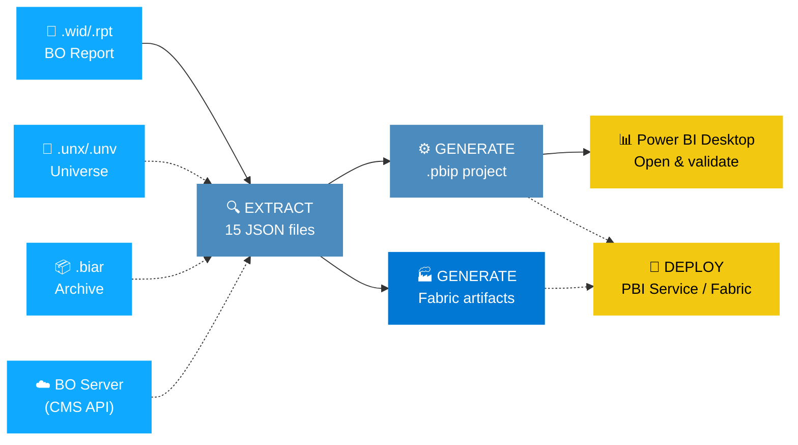
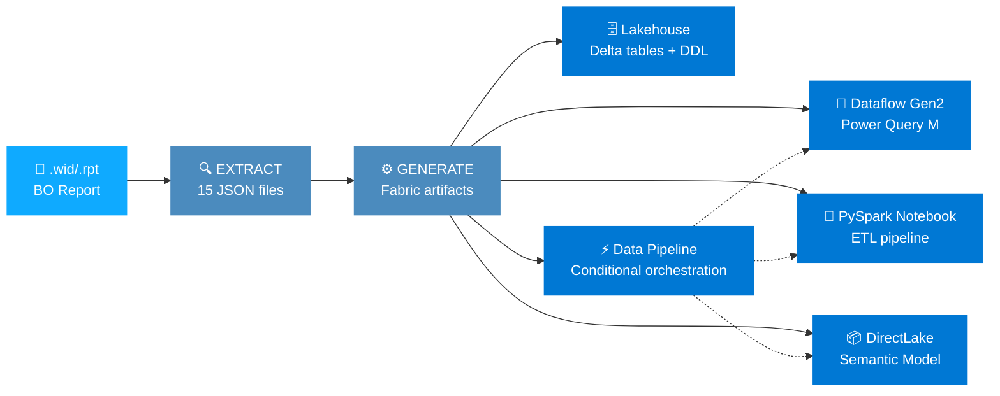
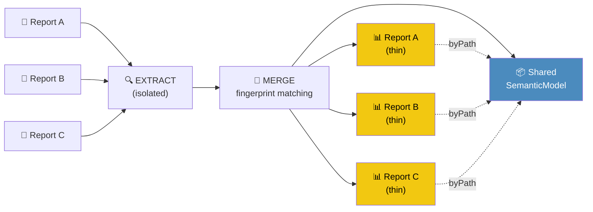
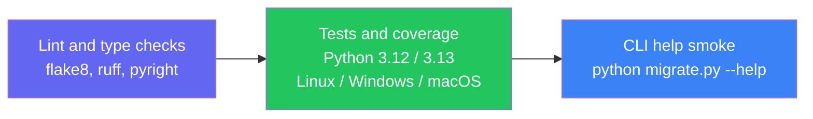

<p align="center">
  
  
  
</p>

<h1 align="center">Business Objects to Power BI Migration</h1>

<p align="center">
  <strong>Generate Power BI migration artifacts from SAP BusinessObjects, with local assessment and explicit conversion limitations.</strong>
</p>

<p align="center">
  
  
  
  
  
  
</p>

<p align="center">
  <a href="#-quick-start">Quick Start</a> •
  <a href="#-key-features">Features</a> •
  <a href="#-how-it-works">How It Works</a> •
  <a href="#-dax-conversions-150-functions">DAX Mappings</a> •
  <a href="#-deployment">Deployment</a> •
  <a href="#-documentation">Docs</a>
</p>

---

## ⚡ Quick Start

```bash
# Generate local artifacts from a source file
python migrate.py report.wid
```

> [!TIP]
> The output is a `.pbip` project intended for Power BI Desktop. Opening, rendering,
> data refresh, and semantic equivalence require separate validation; they are not
> established by successful local generation.

> [!WARNING]
> Extracted connection strings can contain credentials and are not automatically
> redacted before JSON export. Treat source files and generated outputs as sensitive.
> Do not commit or share them without a credential review.

<details>
<summary><b>📦 Installation</b></summary>

```bash
git clone <repo-url>
cd BOToPowerBI
python migrate.py report.wid
```

**Requirements:** Python 3.12+ • No `pip install` needed — pure standard library.

Optional dependencies:
```bash
pip install azure-identity requests   # Fabric/PBI Service deployment
```
</details>

### More ways to migrate

```bash
# 📝 Crystal Report
python migrate.py report.rpt --output-dir /tmp/output

# 📦 Batch migration from BIAR archive
python migrate.py --biar export.biar --output-dir /tmp/batch

# ☁️ Download and extract from BO Server (CMS); not full project generation
python migrate.py --server https://bo-server:6405 --folder "/Public/Sales" \
    --user admin --auth enterprise

# 🔍 Pre-migration readiness check
python migrate.py report.wid --assess

# 🏭 Fabric-native output
python migrate.py report.wid --output-format fabric

# 🔗 Shared Semantic Model — merge multiple reports
python migrate.py --shared-model r1.wid r2.wid --model-name "Shared Sales"

# 🚀 Migrate + deploy to Fabric in one shot
python migrate.py report.wid --deploy WORKSPACE_ID --deploy-refresh

# 📅 Generate refresh config from BO schedules
python migrate.py report.wid --refresh-config

# 🏢 Multi-tenant deployment
python migrate.py report.wid --multi-tenant tenants.json

# 🔄 Incremental migration (skip unchanged artifacts)
python migrate.py report.wid --incremental

# 📊 Schema drift detection against previous extraction
python migrate.py report.wid --schema-drift /prev/extraction/

# 🧙 Dry run (no output files)
python migrate.py report.wid --dry-run
```

The server path currently downloads and extracts files. It does not perform
portfolio assessment or target generation; `--global-assess` and `--dry-run`
do not make that path an assessment-only/read-only operation. Use local sources
with `--assess` or `--dry-run` for those contracts. Deployment flags below are
single-file hooks, not verified cloud outcomes; inspect service results separately.

---

## Local Quality And MCP

```powershell
# Read-only validation of already generated projects; nonzero exit on errors
python migrate.py --validate-project artifacts/bo-sales --quality-output artifacts/quality.json

# Also fail CI on warnings
python migrate.py --validate-project artifacts/bo-sales --quality-strict

# Discover the six local migration tools
python -m powerbi_import.mcp_server --list
```

`--assess` now evaluates without generation; `--dry-run` leaves no persistent
extraction or project output. Directory batches generate isolated projects and
write a manifest with per-source status and a nonzero exit code on partial failure.
Shared-model and BIAR CLI workflows invoke the existing generators rather than
stopping at extraction. `--no-compare` and `--no-optimize-dax` are honored for
single-file/directory workflows.

The workspace MCP server starts read-only. Local generation requires both server
`--allow-write` and per-call confirmation, and cannot overwrite nonempty outputs.
It does not deploy to Fabric. See [MCP setup](docs/FABRIC_MCP_SETUP.md) and the
[dated capability comparison](docs/GAP_ANALYSIS.md#tableautopowerbi-comparison---2026-10-27).

Local quality is not proof of Desktop rendering, refresh, or Fabric execution.
Fabric bundles still require identity/connection binding; the current semantic
wrapper emits entity-based Direct Lake partitions for source tables and a shared
OneLake expression. Calculated utility tables that remain Import are flagged.
Dataflow Gen2 includes its mashup, query metadata, and platform manifest;
notebooks include persistent lakehouse dependencies. Each bundle records local
validation in `fabric_project_metadata.json`. Missing bindings and unsupported BO
semantics remain explicit findings, not proof of deployability.

Fabric ingestion has a single owner per table: CSV/Excel files use the Notebook;
connected sources and custom SQL use Dataflow Gen2. Calculated columns are
materialized only in the primary ETL notebook, after ingestion. Bundles persist
an `ingestion_plan` and `materialization` contract which local validation checks
against emitted Dataflow targets, notebook writes, and pipeline dependencies.

Fabric generation returns exit code **6** when local quality has blocking errors,
including single-file, BIAR, batch, and shared-model workflows. Generated artifacts
and per-project `quality_report.json` remain available for diagnosis; deployment
is not reached for a blocked single-project migration. Warnings alone do not
block generation. Use `--validate-project ... --quality-strict` to reject warnings
as well. The local MCP `migrate` tool reports such a failure with `isError: true`,
`ok: false`, its exit code, and `quality_report` when `output_format` is `fabric`.

## 🎯 Key Features

<table>
<tr>
<td width="50%">

### 🔍 Complete Extraction
Parses **15 object types** from `.wid`/`.rpt`/`.unx`/`.biar`:
reports, queries, datasources, formulas, prompts, filters, tables, columns, joins, groups, sorts, alerts, subreports, charts, custom SQL

**8 source formats:** WebI, Crystal Reports, Universe UNX/UNV, BIAR, LCMBIAR, Lumira Discovery, Lumira Designer

</td>
<td width="50%">

### 🧮 150+ DAX Conversions
Translates BO formulas to DAX:
aggregation, text, date, math, null handling, running calculations, context operators (In/ForEach/ForAll/Where), @Aggregate_Aware, security functions, Crystal syntax

</td>
</tr>
<tr>
<td>

### 📊 50+ Visual Types
Maps BO chart types to Power BI:
bar, line, area, pie, scatter, map, treemap, waterfall, funnel, gauge, KPI, box plot, word cloud, matrix, combo charts, and more

</td>
<td>

### 🔌 15+ Data Connectors
Generates Power Query M for:
SQL Server, PostgreSQL, Oracle, MySQL, SAP HANA, BigQuery, Snowflake, Databricks, Excel, CSV, OData, SharePoint, Azure SQL, and more

</td>
</tr>
<tr>
<td>

### 🧠 Smart Semantic Model
Generates relationships, display folders, number formats, parameters, and supported RLS metadata. Import mode can add Calendar/date parts; Direct Lake defers automatic date enrichments absent upstream. Security and calculation equivalence need separate validation.

</td>
<td>

### 🚀 Deployment Hooks
Single-file deployment and multi-tenant hooks are available, with optional cloud dependencies. Shared CLI deployment is not wired. Authentication, binding, publication, and refresh require separately authorized environment checks.

</td>
</tr>
<tr>
<td>

### 🏭 Fabric-Native Output
Generate **Lakehouse + Dataflow Gen2 + PySpark Notebook + DirectLake Semantic Model + Data Pipeline** with `--output-format fabric`. Full Fabric project from a single BO report.

</td>
<td>

### ⚡ DAX Optimizer
Auto-rewrites verbose DAX: nested IF→SWITCH, IF(ISBLANK)→COALESCE, constant folding, SUMX simplification

</td>
</tr>
<tr>
<td>

### 🔗 Shared Semantic Model
Merge multiple BO reports into **one shared semantic model** with thin reports. Fingerprint-based table matching, Jaccard column overlap scoring, conflict resolution, and merge assessment.

</td>
<td>

### 🔒 Security Profile Migration
BO security profiles → PBI RLS roles with DAX filter expressions. Supports =, InList, Between, <>, Like operators. Generates PowerShell scripts for Azure AD group assignment.

</td>
</tr>
<tr>
<td colspan="2">

### 🔄 Enterprise-Grade Pipeline
Assessment engine (9-category readiness scoring) • Schedule migration (BO instances → PBI refresh config) • Incremental migration (skip unchanged artifacts) • Schema drift detection • Multi-tenant deployment • Governance & telemetry

</td>
</tr>
</table>

> [!NOTE]
> **Zero external dependencies** for core migration. The entire engine runs on Python's standard library.

---

## 🔧 How It Works



**Step 1 — Extract:** Parses BO artifacts into 15 structured JSON files (reports, queries, formulas, etc.)

**Step 2 — Generate:** Converts JSON into a complete `.pbip` project with PBIR v4.0 report and TMDL semantic model

**Step 3 — Validate and deploy** *(separate authorization):* Review quality findings, bind the target environment, and verify service-side publication and refresh. Server extraction and shared generation do not automatically execute this step.

### 🏭 Fabric-Native Output Mode

Use `--output-format fabric` to generate a **full Microsoft Fabric project**:



| Artifact | Description |
|----------|-------------|
| **Lakehouse** | Delta table schemas, Spark SQL DDL scripts, table metadata |
| **Dataflow Gen2** | Connected-source/custom-SQL ingestion with Lakehouse destinations; no file ingestion or calculated-column injection |
| **PySpark Notebook** | One primary ETL notebook for CSV/Excel ingestion and once-only calculated-column materialization |
| **Semantic Model** | DirectLake TMDL pointing to Lakehouse Delta tables |
| **Data Pipeline** | Connected/mixed: Dataflow → Notebook → Semantic Model refresh; file-only: Notebook → Semantic Model refresh |

### 🔗 Shared Semantic Model Mode

Merge multiple BO reports that share data sources into **one shared semantic model** + **N thin reports**:

Shared merging retains physical tables, columns, source connections, and workbook
provenance, including tables classified as isolated. Isolation does not invent a
relationship or authorize data loss. Matching physical identities can union known
columns; the same table/query name on distinct physical sources is rejected until
an explicit source-qualified mapping is available. The BO adapter preserves both
Power BI types and the source-type metadata consumed by Fabric generators.

The eFashion and HR Universe example pair is covered by a real CLI regression:
shared Fabric generation retains 11 ingestion tables and passes local validation
with warnings. This does not prove runtime refresh or deployment. In Direct Lake,
automatic Calendar M tables and derived date-part columns are deferred unless
provided upstream; physical date columns and explicit source hierarchies remain.
Import mode retains its existing automatic Calendar/date-part behavior.



```bash
# Assess merge feasibility
python migrate.py --shared-model r1.wid r2.wid --assess-merge

# Local example: inspect compatibility first
python migrate.py --shared-model examples/eFashion_Universe.unx examples/HR_Universe.unx --assess-merge

# These independent universes need explicit approval of the low-overlap merge
python migrate.py --shared-model examples/eFashion_Universe.unx examples/HR_Universe.unx --force-merge --model-name "Shared Universes" --output-dir artifacts/shared-universes
```

Without `--force-merge`, this example pair is declined for low overlap (exit 5).
Forcing bypasses the merge recommendation, not physical-source ambiguity:
Enterprise Sales/Financial Report still reject distinct same-named `FreehandSQL`
sources (exit 3). The shared CLI does not invoke deployment even if `--deploy`
is supplied; standalone `--deploy-bundle` is not a working publish command.

### 📂 Generated Output

```
YourReport/
├── YourReport.pbip                     ← Double-click to open in PBI Desktop
├── migration_metadata.json             ← Stats, fidelity scores, warnings
├── credentials_template.json           ← Datasource credential placeholders
├── YourReport.SemanticModel/
│   └── definition/
│       ├── model.tmdl                  ← Tables, measures, relationships
│       ├── expressions.tmdl            ← Power Query M queries
│       ├── roles.tmdl                  ← Row-Level Security (from BO profiles)
│       └── tables/
│           ├── Sales.tmdl              ← Columns + DAX measures
│           └── Calendar.tmdl           ← Auto-generated date table
└── YourReport.Report/
    └── definition/
        ├── report.json                 ← Report config + theme
        └── pages/
            └── ReportSection/
                ├── page.json           ← Layout + filters
                └── visuals/
                    └── [id]/visual.json ← Each visual
```

---

## 📋 Supported Source Formats

| Format | Extension | Description |
|--------|-----------|-------------|
| Web Intelligence | `.wid` | WebI documents (reports, queries, variables, prompts) |
| Crystal Reports | `.rpt` | Crystal report files (formulas, subreports, parameters) |
| Universe (UNX) | `.unx` | Information Design Tool universes (business layer + data foundation) |
| Universe (UNV) | `.unv` | Designer universes (legacy) |
| BIAR Archive | `.biar` | BO content archive (batch export) |
| LCMBIAR | `.lcmbiar` | Lifecycle Management archive |
| Lumira Discovery | `.lumx` | SAP Lumira discovery documents |
| Lumira Designer | `.lums` | SAP Lumira Designer applications |

---

## 🧮 DAX Conversions (150+ functions)

<details>
<summary><b>📋 Complete conversion table</b> (click to expand)</summary>

| Category | BO Formula | DAX Equivalent |
|----------|-----------|----------------|
| Aggregation | `=Sum([Revenue])` | `SUM('Table'[Revenue])` |
| Aggregation | `=Count([OrderID])` | `COUNT('Table'[OrderID])` |
| Aggregation | `=Average([Price])` | `AVERAGE('Table'[Price])` |
| Aggregation | `=DistinctCount([Customer])` | `DISTINCTCOUNT('Table'[Customer])` |
| Text | `=Substr([Name],1,3)` | `MID('Table'[Name], 1, 3)` |
| Text | `=Pos([Name],"A")` | `SEARCH("A", 'Table'[Name])` |
| Text | `=Length([Name])` | `LEN('Table'[Name])` |
| Text | `=Upper([Name])` | `UPPER('Table'[Name])` |
| Date | `=Year([Date])` | `YEAR('Table'[Date])` |
| Date | `=Month([Date])` | `MONTH('Table'[Date])` |
| Date | `=DaysBetween([Start],[End])` | `DATEDIFF('Table'[Start], 'Table'[End], DAY)` |
| Logic | `=If [X]>0 Then "Y" Else "N"` | `IF('Table'[X] > 0, "Y", "N")` |
| Logic | `=If ... ElseIf ...` | `SWITCH(TRUE(), ...)` |
| Math | `=Round([Value],2)` | `ROUND('Table'[Value], 2)` |
| Math | `=Truncate([Value],2)` | `TRUNC('Table'[Value], 2)` |
| Running | `=RunningSum([Revenue])` | `CALCULATE(SUM(...), FILTER(ALLSELECTED(...)))` |
| Running | `=RunningCount([OrderID])` | `CALCULATE(COUNT(...), FILTER(ALLSELECTED(...)))` |
| Context | `=Sum([Rev]) In ([Region])` | `CALCULATE(SUM(...), ALLEXCEPT('T', 'T'[Region]))` |
| Context | `=Sum([Rev]) ForEach ([Product])` | `SUMX(VALUES('T'[Product]), SUM(...))` |
| Context | `=Sum([Rev]) ForAll` | `CALCULATE(SUM(...), ALL('T'))` |
| Context | `=Sum([Rev]) Where ([X]>0)` | `CALCULATE(SUM(...), FILTER('T', [X]>0))` |
| Universe | `@Aggregate_Aware(e1, e2, e3)` | `SWITCH(TRUE(), HASONEVALUE(...), e1, ...)` |
| Security | `=CurrentUser()` | `USERPRINCIPALNAME()` |
| Null | `=IsNull([X])` | `ISBLANK('Table'[X])` |
| Null | `=IfNull([X],0)` | `IF(ISBLANK('Table'[X]), 0, 'Table'[X])` |
| Crystal | `{Table.Field}` | `'Table'[Field]` |
| Crystal | `{@FormulaName}` | `[FormulaName]` |
| Crystal | `{?Parameter}` | `[Parameter]` |
| Crystal | `CStr(expr)` | `FORMAT(expr)` |
| Crystal | `DateAdd("m",1,{Date})` | `DATEADD([Date], 1, MONTH)` |

</details>

### Highlights

```
┌─────────────────────────────────────────────────────────────────────────────┐
│  BO Context Operators              →  Power BI DAX                         │
├─────────────────────────────────────────────────────────────────────────────┤
│  =Sum([Revenue]) In ([Region];[Year])                                      │
│  → CALCULATE(SUM('Sales'[Revenue]), ALLEXCEPT('Sales', 'Sales'[Region],    │
│      'Sales'[Year]))                                                        │
│                                                                             │
│  =Sum([Revenue]) ForEach ([Product];[Category])                             │
│  → SUMX(CROSSJOIN(VALUES('T'[Product]), VALUES('T'[Category])),            │
│      SUM('T'[Revenue]))                                                     │
│                                                                             │
│  @Aggregate_Aware(SUM([Rev_Detail]), SUM([Rev_Month]), SUM([Rev_Year]))     │
│  → SWITCH(TRUE(), HASONEVALUE('T'[Detail]), SUM('T'[Rev_Detail]),          │
│      HASONEVALUE('T'[Month]), SUM('T'[Rev_Month]), SUM('T'[Rev_Year]))     │
│                                                                             │
│  =RunningSum([Revenue])                                                     │
│  → CALCULATE(SUM('T'[Revenue]), FILTER(ALLSELECTED('T'), TRUE()))          │
└─────────────────────────────────────────────────────────────────────────────┘
```

---

## 📊 Extracted Objects (15 types)

| Type | JSON File | Source |
|------|-----------|--------|
| reports | `reports.json` | WebI report tabs, Crystal report sections |
| queries | `queries.json` | WebI data providers, Crystal record sources |
| datasources | `datasources.json` | Universe connections, direct DB connections |
| formulas | `formulas.json` | WebI variables, Crystal formulas |
| prompts | `prompts.json` | WebI prompts, Crystal parameters |
| filters | `filters.json` | Query filters, report filters, section filters |
| tables | `tables.json` | Universe tables/classes, derived tables |
| columns | `columns.json` | Universe objects, dimensions, measures, details |
| joins | `joins.json` | Universe joins, contexts, loops |
| groups | `groups.json` | Crystal groups, WebI breaks, sections |
| sorts | `sorts.json` | Sort definitions |
| alerts | `alerts.json` | WebI alerters, Crystal conditional formatting |
| subreports | `subreports.json` | Crystal subreports, WebI report linking |
| charts | `charts.json` | Chart definitions (type, axes, series) |
| custom_sql | `custom_sql.json` | Freehand SQL, derived tables |

---

## 🏗️ Architecture

> 22 specialist development roles, not runtime pipeline stages — see [docs/AGENTS.md](docs/AGENTS.md) for details.

<details>
<summary><b>📁 Project structure</b> (click to expand)</summary>

```
BOToPowerBI/
├── migrate.py                          # CLI entry point (30+ flags)
├── generate_report.py                  # HTML dashboard generator
├── pyproject.toml                      # Build config
├── bo_export/                          # 🔍 Extraction layer
│   ├── extract_bo_data.py              #   Main orchestrator (.wid/.rpt/.unx/.biar)
│   ├── webi_extractor.py              #   Web Intelligence extraction
│   ├── crystal_extractor.py           #   Crystal Reports extraction
│   ├── universe_extractor.py          #   Universe (UNX/UNV) extraction
│   ├── lumira_extractor.py            #   Lumira extraction
│   ├── biar_reader.py                 #   BIAR/LCMBIAR archive reader
│   ├── dax_converter.py               #   150+ BO formula → DAX
│   ├── m_query_builder.py             #   Power Query M generator (15+ connectors)
│   ├── server_client.py               #   BO CMS REST API client
│   └── converted_objects_adapter.py   #   Bridge: 15 JSON types → generation layer
├── powerbi_import/                     # ⚙️ Generation layer
│   ├── import_to_powerbi.py           #   Orchestrator
│   ├── pbip_generator.py              #   .pbip project + visuals + filters
│   ├── tmdl_generator.py              #   Semantic model → TMDL
│   ├── visual_generator.py            #   50+ visual types, PBIR configs
│   ├── assessment.py                  #   Pre-migration assessment (9 categories)
│   ├── dax_optimizer.py               #   DAX AST optimizer
│   ├── permission_mapper.py           #   BO security profiles → RLS + PowerShell
│   ├── shared_model.py                #   Multi-report merge engine
│   ├── refresh_generator.py           #   BO schedules → PBI refresh config
│   ├── incremental.py                 #   Incremental migration
│   ├── schema_drift.py                #   Schema drift detection
│   ├── validator.py                   #   Artifact validation + auto-fix
│   ├── governance.py                  #   Governance rules
│   ├── deploy/                        #   Deploy to PBI Service / Fabric
│   │   ├── deployer.py                #     Fabric deployment
│   │   └── multi_tenant.py            #     Multi-tenant deployment
│   └── ...                            #   (50+ modules from generation engine)
├── tests/                              # Unit, integration, and contract tests
├── docs/                               # 📚 Architecture, dev plan, enterprise guide
└── .github/
    ├── agents/                         # 22 specialist development roles
    └── copilot-instructions.md
```

</details>

---

## 📝 CLI Reference

<details>
<summary><b>🔧 All CLI flags</b> (click to expand)</summary>

| Flag | Description |
|------|-------------|
| `input` | Path to `.wid`, `.rpt`, `.unx`, `.unv`, `.lumx`, or `.lums` file |
| `--biar FILE` | Path to BIAR/LCMBIAR archive for batch migration |
| `--batch DIR` | Directory containing BO artifacts for batch migration |
| `--server URL` | BO CMS download/extraction path; not target generation |
| `--folder PATH` | Server folder to migrate |
| `--user NAME` | BO server username |
| `--password SECRET` | BO server password |
| `--auth TYPE` | Authentication type: `enterprise`, `ldap`, `windows`, `sap` |
| `--output-dir DIR` | Custom output directory |
| `--output-format FORMAT` | Output format: `pbip` (default) or `fabric` |
| `--shared-model FILE [FILE ...]` | Build shared semantic model from multiple reports |
| `--model-name NAME` | Name for shared semantic model |
| `--assess` | Run migration readiness assessment |
| `--global-assess` | Parsed flag; server portfolio-assessment dispatch is not connected |
| `--assess-merge` | Inspect shared-model compatibility without generation |
| `--force-merge` | Approve a low-overlap merge; does not resolve source ambiguity |
| `--validate-project DIR` | Run local PBIP/Fabric quality checks |
| `--quality-output FILE` | Save validation JSON with `--validate-project` |
| `--quality-strict` | Fail local validation on warnings as well as errors |
| `--deploy WORKSPACE_ID` | Single-file deployment hook; ignored by shared CLI |
| `--deploy-refresh` | Trigger refresh after deployment |
| `--deploy-bundle WORKSPACE_ID` | Parsed but not wired to a usable standalone CLI publish path |
| `--refresh-config` | Generate PBI scheduled refresh config from BO schedules |
| `--multi-tenant CONFIG` | Multi-tenant deployment config JSON |
| `--incremental` | Incremental migration: skip unchanged artifacts |
| `--schema-drift DIR` | Schema drift detection against previous extraction |
| `--calendar-start YEAR` | Calendar table start year (default: 2020) |
| `--calendar-end YEAR` | Calendar table end year (default: 2030) |
| `--culture LOCALE` | Locale for date formatting (default: `en-US`) |
| `--dry-run` | No persistent outputs for local file/batch/BIAR/shared paths; not enforced by server path |
| `--verbose` / `-v` | Enable debug logging |
| `--no-optimize-dax` | Skip DAX optimization pass |
| `--no-compare` | Skip comparison report generation |
| `--universe FILE` | Path to universe file for additional metadata |

</details>

---

## 🚀 Deployment

The examples below describe optional single-file hooks, not verified deployment
recipes. They need a separately approved identity, workspace, connection bindings,
and the optional cloud dependencies. Read the [Fabric/MCP setup](docs/FABRIC_MCP_SETUP.md)
and coordinate remote writes with Deployer. CLI exit 0 alone does not establish
publication: deployment exceptions can be logged without a failing migration
exit code. Inspect service results and refresh separately. Shared CLI deployment
and standalone `--deploy-bundle` are not wired; Desktop/cloud checks are `not_run`.

<details>
<summary><b>Power BI Service</b></summary>

```bash
# Optional single-file hook, only after environment/authorization checks
python migrate.py report.wid --deploy WORKSPACE_ID --deploy-refresh
```
</details>

<details>
<summary><b>Microsoft Fabric</b></summary>

```bash
# Fabric-native output (Lakehouse + Dataflow + Notebook + DirectLake)
python migrate.py report.wid --output-format fabric

# Optional single-file hook; not evidence that the generated bundle runs
python migrate.py report.wid --deploy WORKSPACE_ID
```
</details>

<details>
<summary><b>Multi-Tenant Deployment</b></summary>

```bash
# Deploy with per-tenant connection overrides
python migrate.py report.wid --multi-tenant tenants.json
```

The `tenants.json` file specifies per-tenant workspace IDs and connection string overrides (`${TENANT_SERVER}`, `${TENANT_DATABASE}`, etc.).
</details>

---

## 🧪 Testing

<p align="center">
  
</p>

```bash
python -m pytest tests/ --tb=short -o addopts="" -q
```

Measured locally on 2026-10-28: **419 passed, 242 subtests passed**. This is a
dated suite result, not a feature-parity score or evidence of Desktop rendering,
deployed refresh, or Fabric execution. See [Contributing](CONTRIBUTING.md) for
test-tool installation. Coverage is a separate CI gate, not measured by this command.

### CI/CD Pipeline



  This describes the [committed CI workflow](.github/workflows/ci.yml), not an
  observed successful CI run. Its coverage threshold is 80%; its final validation
  job only runs CLI help. It does not generate sample projects, deploy staging or
  production, enforce a manual release approval, or test Python 3.14.

---

## 📚 Documentation

| Document | Description |
|----------|-------------|
| 🏗️ [Architecture](docs/ARCHITECTURE.md) | System design overview |
| 🤖 [Agents](docs/AGENTS.md) | 22 specialist roles and tested ownership boundaries |
| 🗓️ [Development Plan](docs/DEVELOPMENT_PLAN.md) | Current evidence/gates and dated historical roadmap |
| 📋 [Gap Analysis](docs/GAP_ANALYSIS.md) | Known conversion gaps |
| 🏢 [Enterprise Guide](docs/ENTERPRISE_GUIDE.md) | Enterprise migration planning |
| [Fabric/MCP Setup](docs/FABRIC_MCP_SETUP.md) | Local engine, workload skills, and remote authorization |

---

## ⚠️ Known Limitations

- Source-embedded credentials can be persisted in extraction JSON; review outputs before sharing
- Server mode downloads/extracts even with assessment/dry-run flags; shared CLI deployment is not wired
- Local tests and generated artifacts do not establish Desktop, refresh, security equivalence, or deployed execution
- BO **Lumira Designer** applications have limited extraction (layout → stub visuals)
- Data source connection strings must be reconfigured in Power Query after migration
- **@Aggregate_Aware** with 5+ levels generates complex SWITCH — may need manual tuning
- Crystal Reports **subreport drill-through** parameters may need manual validation
- See [docs/GAP_ANALYSIS.md](docs/GAP_ANALYSIS.md) for the full list

---

## 🤝 Contributing

Contributions use 22 specialist roles — see [docs/AGENTS.md](docs/AGENTS.md) for scope ownership and [CONTRIBUTING.md](CONTRIBUTING.md) for the development setup.

```bash
git clone <repo-url>
cd BOToPowerBI
python -m pip install "pytest>=8.0" "pytest-cov>=5.0" "ruff>=0.3.0" "pyright>=1.1.350"
python -m pytest tests/ -q   # Make sure tests pass
```

---

<p align="center">
  <sub>Built with ❤️ for the Power BI community</sub><br/>
  <sub>If this tool saves you time, consider giving it a ⭐</sub>
</p>

## License

MIT
