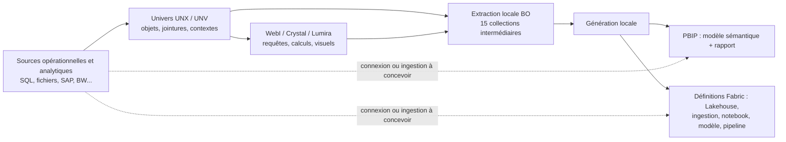
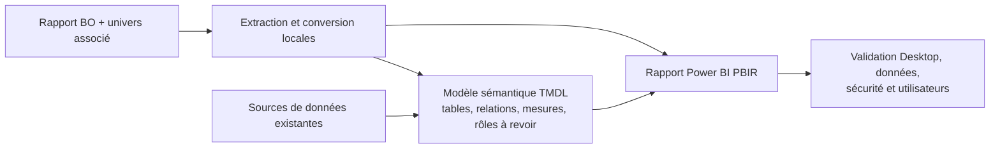
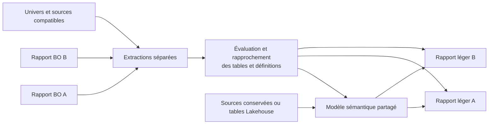
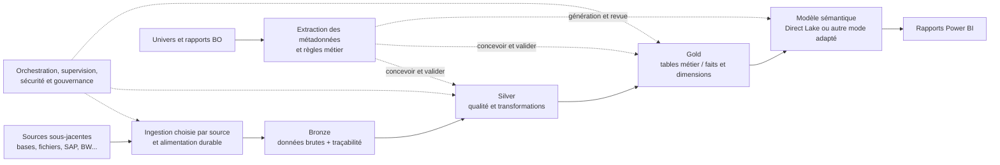

# Architectures de migration SAP BusinessObjects

Ce guide aide à choisir une cible pour les rapports et univers BO, puis à
organiser leur migration vers Power BI et, si nécessaire, Fabric. Les schémas
décrivent des **architectures cibles** : ils ne signifient pas que le dépôt
exécute toutes les opérations représentées.

## 1. Point de départ : BO n'est pas la source de toutes les données



L'univers décrit notamment une couche métier et des accès aux données ; un
rapport décrit aussi des requêtes, calculs et présentations. Les artefacts
extraits ne constituent pas une copie complète, historique et validée des
données des systèmes sous-jacents. Inventorier séparément sources, propriétaires,
droits d'accès, volumétries, historiques, fréquence, traitements et consommateurs.
Une connexion directe à BW peut être transitoire, mais ne permet pas à elle seule
de retirer BW. Pour ce chantier distinct, voir le
[design BW vers Fabric](SAP_BW_TO_FABRIC_DESIGN.md).

## 2. Choisir la cible

| Situation | Cible à examiner | Arbitrages |
|---|---|---|
| Un rapport autonome, source conservée et accessible | PBIP avec modèle sémantique propre au rapport | Simple pour un pilote ; duplication possible des définitions et des rafraîchissements |
| Plusieurs rapports avec données et définitions métier compatibles | Modèle sémantique partagé et rapports légers | Mutualisation ; gouvernance des mesures, compatibilité des sources et gestion des changements indispensables |
| Données à réutiliser, historiser ou transformer au-delà des rapports | Lakehouse Fabric, puis modèle sémantique et rapports | Ingestion et exploitation supplémentaires ; sécurité, coûts, historique et alimentation durable à concevoir |

Ce ne sont pas des cibles mutuellement exclusives : un modèle partagé peut
consommer des tables Lakehouse. Le choix dépend notamment des sources réelles,
des contraintes de fraîcheur, du volume, des licences, de la sécurité et des
consommateurs. Le mode **Import**, **DirectQuery** ou **Direct Lake** doit être
choisi et testé pour chaque architecture ; un univers BO ne détermine pas ce
mode à lui seul.

## 3. Parcours A : modèle sémantique par rapport



1. Recenser le document, son univers, les requêtes et sources effectives.
2. Évaluer le rapport, puis générer un PBIP local. Examiner séparément
   l'univers et vérifier la couverture des métadonnées nécessaires.
3. Vérifier les tables, granularités, jointures, formules, filtres, prompts,
   visuels et règles de sécurité. Revoir les conversions signalées et les
   fonctionnalités qui exigent une reconstruction manuelle.
4. Configurer les connexions et, si nécessaire, la passerelle dans
   l'environnement autorisé. Ouvrir le PBIP et comparer les résultats à BO.

Exemple local, avec des fichiers synthétiques du dépôt :

```powershell
python migrate.py "examples\Enterprise_Sales.wid" --assess
python migrate.py "examples\Enterprise_Sales.wid" --output-dir "artifacts\bo-report"
python migrate.py --validate-project "artifacts\bo-report\Enterprise_Sales" --quality-output "artifacts\bo-report-quality.json"
```

L'option `--universe` apparaît dans l'aide du CLI mais n'est actuellement pas
raccordée au parcours de génération d'un rapport unique : ne pas considérer
qu'elle ajoute automatiquement les métadonnées de l'univers au rapport. Une
extraction d'univers séparée ne garantit pas non plus leur fusion dans ce
parcours. La validation locale ne remplace ni l'ouverture Desktop, ni le
rafraîchissement, ni la comparaison métier.

## 4. Parcours B : modèle sémantique partagé



1. Grouper les rapports par domaine, sources **physiques**, granularité et
   définitions métier, pas uniquement par nom d'univers.
2. Évaluer le rapprochement et faire résoudre les ambiguïtés par les
   propriétaires. Une table isolée est conservée ; cela ne crée pas une relation.
3. Générer le modèle et les rapports, puis contrôler les mesures communes et
   spécifiques, relations, sécurité et impacts d'un changement partagé.
4. Comparer chaque rapport source à son équivalent cible et valider les usages.

```powershell
python migrate.py --shared-model "examples\eFashion_Universe.unx" "examples\HR_Universe.unx" --assess-merge
```

Cet exemple d'univers indépendants présente un faible recouvrement. Le
[README](../README.md#-shared-semantic-model-mode) documente la génération avec
approbation explicite `--force-merge` : celle-ci ne résout pas une ambiguïté
entre sources physiques distinctes. Ne jamais forcer un rapprochement sans
revue. Le chemin partagé ne publie pas les artefacts via `--deploy` ; prévoir
une publication séparée et autorisée.

## 5. Parcours C : Lakehouse Fabric puis modèle sémantique



**Architecture de référence, non générée intégralement par le dépôt.** Bronze,
Silver et Gold peuvent être des schémas d'un Lakehouse compatible ou des
Lakehouses/workspaces séparés selon les exigences d'isolation. Concevoir
historiques, reprise, chargements incrémentaux, suppressions, contrats de
données, conservation et qualité selon les garanties de chaque source.
Un watermark seul ne prouve pas la capture des suppressions.

Pour le mode Fabric actuel, `--output-format fabric` produit **localement** des
définitions Lakehouse/DDL, Dataflow Gen2, notebook PySpark, modèle Direct Lake
et pipeline. Il ne génère pas automatiquement une architecture complète en
trois couches ni une alimentation historique ou incrémentale fiable de toutes
les sources. CSV/Excel sont affectés au notebook ; sources connectées et SQL
personnalisé au Dataflow ; les colonnes calculées sont matérialisées dans le
notebook principal après ingestion. Inspecter le plan d'ingestion, de
matérialisation et les constats de qualité avant de poursuivre.

```powershell
python migrate.py "examples\Enterprise_Sales.wid" --assess
python migrate.py "examples\Enterprise_Sales.wid" --output-format fabric --output-dir "artifacts\bo-fabric"
python migrate.py --validate-project "artifacts\bo-fabric\Enterprise_Sales" --quality-output "artifacts\bo-fabric-quality.json"
```

La génération Fabric échoue avec le code **6** en présence de constats locaux
bloquants et conserve les rapports de qualité pour diagnostic ; les
avertissements seuls ne bloquent pas. Utiliser `--quality-strict` lors de la
validation pour traiter aussi les avertissements comme bloquants. Les
connexions, identités et liaisons manquantes doivent être résolues dans
l'environnement cible après autorisation.
Sur l'exemple synthétique `Enterprise_Sales`, la génération locale est
actuellement bloquée par des calculs/groupes BO nécessitant une reprise
manuelle : l'exemple illustre le diagnostic, pas un déploiement prêt à l'emploi.

Pour Direct Lake, vérifier les tables Delta, les types, les relations et le
rafraîchissement/framing. Les tables Direct Lake générées utilisent des
partitions d'entité et une expression OneLake partagée ; certaines tables
utilitaires peuvent rester en Import et sont signalées. Les enrichissements
automatiques de calendrier et de dates en Import ne sont pas équivalents à une
matérialisation amont en Direct Lake. Direct Lake sur OneLake ne propose pas de
repli DirectQuery ; Direct Lake sur point de terminaison SQL peut en proposer
selon la configuration et le scénario. Tester le mode effectivement déployé,
ses permissions et sa performance, sans supposer que les deux variantes sont
interchangeables.

## 6. Traduction des concepts : propositions à valider

| Objet ou comportement BO | Cible possible | Point de contrôle |
|---|---|---|
| Univers, classes et objets métier | Tables, colonnes, mesures et dossiers d'un modèle sémantique | Périmètre, définitions partagées et droits |
| Jointures et contextes d'univers | Relations, vues ou transformations en amont | Cardinalité, chemins de filtre, pièges de jointure et granularité |
| Objets de type mesure et variables | Mesures DAX ou calculs en amont | Contexte d'évaluation, agrégations, arrondis et valeurs nulles |
| Tables dérivées et SQL personnalisé | Requête source, Dataflow ou transformation Lakehouse | Compatibilité SQL, performances et accès à la source |
| Prompts, filtres, contrôles et listes de valeurs | Paramètres, segments ou filtres | Valeurs obligatoires, défauts, dépendances et expérience utilisateur |
| Onglets, graphiques et alerteurs | Pages, visuels et mise en forme conditionnelle | Rendu, navigation, interaction et fonctionnalités non converties |
| Profils de sécurité et restrictions | Rôles du modèle, droits Fabric et contrôles sur les données | Tests d'accès autorisé **et refusé**, y compris accès direct aux données |
| Planifications et instances BO | Rafraîchissement, orchestration et distribution à définir | Fuseaux, fréquence, destinataires, échecs et historique |

Ces correspondances ne sont pas des équivalences automatiques. Notamment,
reproduire une sécurité RLS au niveau du modèle ne protège pas nécessairement
les autres chemins d'accès au Lakehouse. Valider chaque chemin et identité.

## 7. Livraison et critères de passage

1. **Inventaire et choix** : dépendances, sources, consommateurs, criticité,
   sécurité, données et cible approuvées par les responsables.
2. **Pilote** : choisir un domaine représentatif ; consigner les écarts,
   conversions manuelles et décisions de modélisation.
3. **Génération locale** : examiner les fichiers produits et le rapport de
   qualité ; corriger ou accepter explicitement les avertissements applicables.
4. **Validation fonctionnelle** : comparer BO et cible avec des jeux
   indépendants, les mêmes filtres et granularités, et des seuils métier
   approuvés ; vérifier totaux, détails, contextes, nulls et cas limites.
5. **Validation technique et sécurité** : ouverture Desktop, actualisation,
   données et performances ; tester les permissions à chaque couche et les
   chemins d'accès directs. Pour Lakehouse, tester ingestion, reprise et
   réconciliation de chaque couche.
6. **Publication et bascule** : après autorisation distincte, lier et publier,
   superviser, exécuter une période parallèle, documenter le retour arrière et
   obtenir l'acceptation métier avant retrait du contenu BO.

Une génération réussie ou un contrôle statique ne prouve pas l'exécution Fabric,
la restitution dans Desktop, l'équivalence métier ni l'autorisation de retrait.
Consigner séparément les contrôles réellement exécutés et ceux restés `not_run`.
Les définitions extraites peuvent contenir des informations de connexion
sensibles : protéger les sorties et les examiner avant partage.

## Références

- [Architecture interne du projet](ARCHITECTURE.md) et
  [guide de migration entreprise](ENTERPRISE_GUIDE.md).
- [Configuration Fabric et MCP](FABRIC_MCP_SETUP.md) et
  [routage des skills Fabric](../.github/skills/fabric-mcp-routing/SKILL.md).
- Microsoft Learn : [fonctionnement de Direct Lake](https://learn.microsoft.com/en-us/fabric/fundamentals/direct-lake-how-it-works)
  et [développement des modèles Direct Lake](https://learn.microsoft.com/en-us/fabric/fundamentals/direct-lake-develop).
