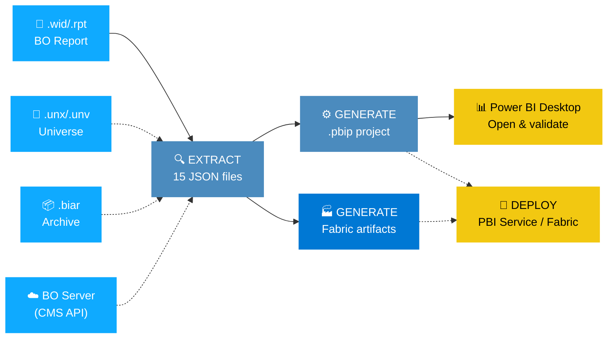
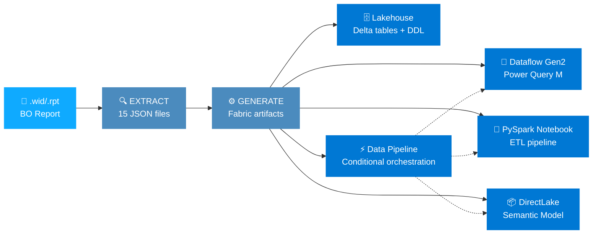
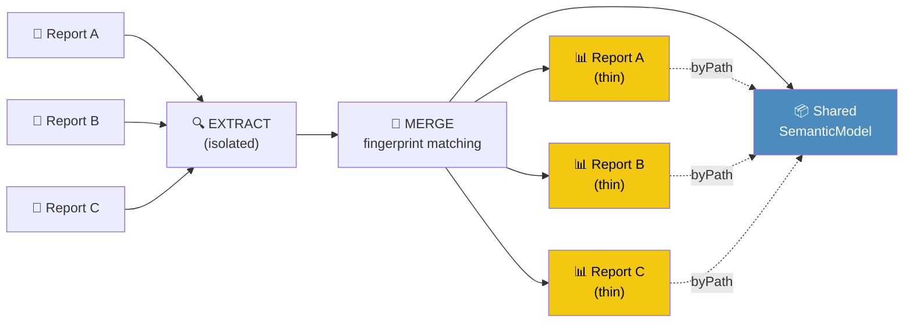
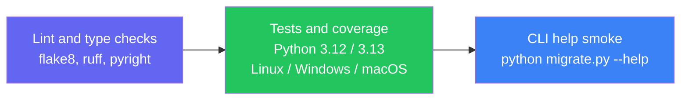

# Advanced migration reference

Detailed procedures and historical local evidence. Start with the concise [README](../README.md); commands and options remain unchanged.

## Additional BO command paths

The positional folder form in the README is preferred. The legacy
`--batch sources` form can reuse a PBIP/Fabric output directory and may
overwrite files; use a new destination. An archive can also be supplied
explicitly:

```powershell
python migrate.py --biar "export.biar" --output-dir "archive-output"
```

Server mode (`--server` and `--folder`) downloads and extracts only; local
assessment and dry-run flags cannot be combined with it. Avoid putting
credentials in command-line arguments. The full flag table below also
describes optional refresh, incremental and schema-drift paths. Multi-tenant
deployment is a separate, unverified path that may perform remote operations;
it requires authorization and is not part of local generation.

#### Read WebI report and data-provider metadata from the CMS

The Python `BOServerClient` exposes read-only report, report-element,
data-provider, query-plan and query-specification calls. Use an authorized CMS
and document ID; enter credentials interactively rather than putting them in
scripts or command lines:

```python
import json
from getpass import getpass
from pathlib import Path
from bo_export.server_client import BOServerClient

server = input("BO server URL: ")
document_id = input("WebI document ID: ")
with BOServerClient(server, username=input("User: "), password=getpass()) as client:
    snapshot = client.get_webi_document_snapshot(
        document_id, include_element_details=True,
        include_provider_query_metadata=True,
    )
    with Path("webi-document.json").open("x", encoding="utf-8") as output:
        json.dump(snapshot, output, ensure_ascii=False, indent=2)
        output.write("\n")
```

The client preserves returned report and element metadata, including positions,
parent IDs and additional fields when supplied by SAP. Optional
`include_element_details=True` requests `allInfo=true` (available since BI
4.2 SP04); unsupported server versions or permissions surface their HTTP
errors. Requests are performed separately for each report and provider.
`include_provider_query_metadata=True` additionally fetches each provider's
query plan and specification; this may include SQL and causes an explicit
failure if an API request is unavailable. The [versioned snapshot schema](schemas/webi_document_snapshot.schema.json)
and [synthetic example](fixtures/webi_document_snapshot.example.json)
describe both capture levels. The snapshot is not imported by the CLI and does
not establish report-to-provider bindings, validate a Power BI report, or prove
completeness. IDs are scoped to their document/report. Treat the snapshot as
sensitive and protect it.

For a snapshot captured with provider query metadata, the Python API
`bo_export.webi_snapshot_adapter.extract_webi_snapshot(snapshot, connection)`
returns the 15 BO collections. It copies the SQL verbatim from providers whose
plan has exactly one direct statement, skipping the rest with a warning, and
applies one explicitly declared SQL Server connection
(`{"name": ..., "server": ..., "database": ...}`, no credentials) to all of
them; the snapshot does not prove that connection is the one each provider
used. Result columns, layout and report-to-provider links are not inferred, so
report tabs produce no worksheet, and `adapt_bo_to_converted_objects` plus
`PowerBIImporter` generate a semantic-model-only PBIP with the SQL partition
(zero columns; the quality report flags the missing Report folder). Refresh, SQL
execution and source equivalence remain `not_run`.

To inspect a data-provider plan separately:

```python
import json
from getpass import getpass
from pathlib import Path
from bo_export.server_client import BOServerClient

server = input("BO server URL: ")
document_id = input("WebI document ID: ")
with BOServerClient(server, username=input("User: "), password=getpass()) as client:
    providers = client.list_webi_data_providers(document_id)
    for provider in providers:
        print(provider["id"], provider.get("name"), provider.get("dataSourceType"))
    provider_id = input("Data-provider ID to inspect: ")
    plan = client.get_webi_query_plan(document_id, provider_id)
    print(plan["status"], plan["single_statement"])
    if plan["single_statement"]:
        with Path("webi-plan.json").open("x", encoding="utf-8") as saved_plan:
            json.dump(plan, saved_plan, ensure_ascii=False, indent=2)
            saved_plan.write("\n")
    # Optional: inspect provider details or its query specification separately.
    # details = client.get_webi_data_provider(document_id, provider_id)
    # specification = client.get_webi_query_specification(document_id, provider_id)
```

`plan["xml"]` preserves the query plan, and `plan["statements"]` contains each
statement with its enclosing operators. An empty plan is reported as `empty`;
HTTP and malformed-response errors are raised. A multi-statement plan is not
flattened into SQL. Review SQL, BO prompts, permissions and the connection before
using an explicit RDL/Power Query mapping. These methods do not automatically
change the `--server` workflow, convert SQL, refresh data or generate a project.
No live CMS compatibility is established by the mocked tests. SQL and query
specifications may contain sensitive information; review them before sharing.
SAP documents the
[report APIs](https://help.sap.com/docs/SAP_BUSINESSOBJECTS_WEB_INTELLIGENCE/d6bd74f8532c4e978419c7300bda43f8/606e9a128c3d49e49c068daa73f8d647.html),
[report elements](https://help.sap.com/docs/SAP_BUSINESSOBJECTS_WEB_INTELLIGENCE/58f583a7643e48cf944cf554eb961f5b/7da1aeaa6f701014aaab767bb0e91070.html),
[data-provider list](https://help.sap.com/docs/SAP_BUSINESSOBJECTS_WEB_INTELLIGENCE/58f583a7643e48cf944cf554eb961f5b/45f8ab646e041014910aba7db0e91070.html),
[query plan](https://help.sap.com/docs/SAP_BUSINESSOBJECTS_WEB_INTELLIGENCE/0ef63ba725cd41a8ab4a69c226ec6b07/fe78458cf8e34524802db4bef738ac16.html),
and [query specification](https://help.sap.com/docs/SAP_BUSINESSOBJECTS_WEB_INTELLIGENCE/d6bd74f8532c4e978419c7300bda43f8/7da09f7a6f701014aaab767bb0e91070.html)
endpoints.

#### From a saved WebI plan to RDL and Power Query

```text
CMS WebI API ----> saved plan ----> review SQL and provider ID ---+
WID metadata ----> provider ID check (optional) ------------------+
User mapping ----> SQL Server, database, fields and labels -------+--> RDL
                                                                  +--> M (optional)
```

The programmatic example above saves the plan without overwriting an existing
file. Keep the saved JSON protected: it includes SQL. Its
[schema](schemas/webi_query_plan.schema.json) and
[synthetic plan](fixtures/webi_query_plan.example.json) describe the
six fields returned by the API client. On load, the CLI re-parses the XML and
checks the derived fields; the declared document and provider IDs are not
authenticated provenance. Responses are limited to 16 MiB, snapshots to
64 MiB and plan nesting to 256 levels.

Provide a separate mapping, as in this
[synthetic SQL Server mapping](fixtures/webi_rdl_mapping.example.json).
It must have `source_kind: "webi"`, a server, database and explicit result
fields; optional labels are literal RDL column headings. Omit `sql` from the
mapping because it comes from the plan. Verify that the SQL is valid for the
declared SQL Server and that the selected fields match its results; neither
connection nor fields are inferred from the WID or API plan.

From the repository root, this example creates two **new** local files:

```powershell
python migrate.py --output-format rdl `
    --rdl-mapping "docs\fixtures\webi_rdl_mapping.example.json" `
    --rdl-webi-plan "docs\fixtures\webi_query_plan.example.json" `
    --rdl-output "webi_sample.rdl" `
    --rdl-power-query-output "webi_sample.m"
```

The server `sql.example.invalid` and all report data in these fixtures are
synthetic. Replace the fixtures with a securely saved real plan and reviewed
mapping before using a real source. The standalone `migrate_paginated.py`
offers the equivalent `--webi-plan` flag. For an optional provider ID
check, add `--rdl-bo-source "path\report.wid"` with the main CLI. An ID such as
`DP0` can occur in multiple documents: a match does **not** prove that the WID
is the API document or that the SQL belongs to any particular report tab.

Only one direct, nonempty `<statement>` under `<queryplan>` is accepted; plans
with multiple statements, operators, other child elements or ambiguous text are
rejected rather than flattened. `--rdl-sql-name` and `--rdl-extracted-sql` are
not used with this mode. Existing SQL shape checks also reject unsupported
queries and unresolved BO macros; they do not prove safety or execution.
Parameterized RDL SQL requires explicit parameter declarations, and the optional
M output does not support parameters. Credentials are configured separately.
The RDL is a basic result table, not a reconstruction of WebI tabs, formulas or
visuals; the `.m` file is a query to use in Power BI, not a PBIX report.
Live CMS compatibility, SQL execution, Report Builder/Desktop rendering and
source equivalence remain `not_run` until separately verified.

#### Experimental native WebI extraction

The local `.wid` extractor can read a bounded subset of native ZIP records:
document specification version 2.5 report-tab names and IDs, section IDs,
table-like visual type IDs and structural row/column descriptor counts, plus
provider names, IDs and explicit result-object identifiers from two observed
provider XML variants. Section and visual IDs are copied from `BID` when
present; recognized `VTABLE`, `HTABLE` and `XTABLE` entries may include
`row_info_count` and `column_info_count`, the counts of descendant `ROWINFO`
and `COLINFO` descriptors (not data-row counts). This is partial structural
metadata in the existing 15 extraction collections, not visual reconstruction:
page coordinates, cell content, expressions, formatting, filters and object
bindings are not converted from the native layout. Result-object names are not
treated as physical SQL columns. Native parsing does not recover SQL or
datasource connections, and does not establish source completeness.
Because a partial native report does not establish its visual layout, the
adapter does not invent a default Power BI table visual for that report tab;
generic reports with no extracted charts retain their existing table fallback.
Unsupported, corrupt, duplicate or oversized native records are warned about
and skipped; native records are limited to 16 MiB each and 64 MiB per archive.
Existing handling of generic `.xml`/`.json` members is unchanged. Where native
report or provider metadata is recovered, migration logs and batch warnings
indicate the partial scope.
Use the CMS API or other verified source metadata for SQL and connections;
review those separately before using a mapping.

For recognized providers, `queries.json` also retains `native_prompt_metadata`
from an observed `PARAMSERVER` record. Its status is `available`,
`not_observed` (at the expected location), or `invalid`; a malformed record
does not discard the provider. The metadata includes the provider ID, ZIP
member path, SHA-256 of the uncompressed member and, for a candidate record,
its offset in that member. Only recognized structural fields such as type,
cardinality, options and order are retained. `native_prompt_metadata` excludes
prompt names, IDs, questions, current, previous and default values, and list
values; unknown structural values are omitted with a warning. This exclusion
does not apply to generic prompt extraction. A member hash or document-scoped
provider ID does not authenticate a CMS document or establish report-to-provider
links.

#### CMS metadata inventory and unbound RDL skeletons

An `.lcmbiar` export carries a readable `BusinessObjects.xml` metadata manifest.
`migrate_lcm_inventory.py` reads it and writes a new output directory:

```powershell
python migrate_lcm_inventory.py --manifest export.lcmbiar --output-dir artifacts\lcm
```

`inventory.json` records documents (Crystal, WebI), universes and data
connections with their CUID relations: which document declares which universe
(WebI providers carry only an ID, a name and a declared source name, not a
universe link), and which connection (network layer, database type) a universe
uses. It also lists Crystal prompts (name, prompt text, multiple/optional/
discrete/locked flags), document descriptions, keywords and file names, and
groups documents by universe as shared-model candidates. Unresolved links are
listed. Connection strings, owners and parameter values are never read or
written.

Unless `--no-rdl` is given, `rdl/` receives one skeleton per document with its
title, CMS description and report parameters. A skeleton has no data source,
dataset, table or formulas. Parameter data types are not in the metadata, so
they default to `String` and must be reviewed; names are normalized to RDL
identifiers and the original name stays in the prompt when none exists.
`skeletons.json` reports each document as `generated` or `skipped` (the exit
code is 1 when any is skipped; an existing output path or an unreadable
archive returns 2).

This does not read the encrypted UNX/Crystal contents, universe business layers,
queries, SQL, layouts or result columns, so it produces no data-bound report or
semantic model. Report Builder rendering is `not_run`. The sample archives it was
verified on are not redistributed with this repository.

These records are evidence, not converted prompts: they do not populate
`prompts.json` or generate Power BI parameters. A native record is merged into
a generic provider only on a unique exact provider-ID match; when a detected
record cannot be matched safely, it is retained as `native_wid_evidence_only`
and excluded from datasource generation. Other extracted metadata can still be
sensitive and must be reviewed before sharing.

In a local replay on 13 downloaded WIDs, extraction retained 29 report tabs,
12 provider records and 18 structural prompt entries. All 13 PBIP migrations
failed; no SQL or datasource was recovered. These samples do not establish
coverage for other WID versions, and missing metadata does not prove that the
source lacks it.

For PBIP/Fabric inspection, no adapted datasource is a RED finding: the folder
importer cannot generate a project in that state. If table metadata instead
produces a synthetic ODBC placeholder, the assessment warns that the actual
connection was not extracted; the placeholder does not establish the connector
type. Missing metadata does not prove a datasource is absent from the source.
SQL entries without a matching SQL-bearing table on an extracted datasource
are flagged for review; a match does not prove correct binding or generation.
An inspection exit code of zero means the assessment ran, not that it is GREEN.
These checks do not assess the separately declared RDL mapping or prove source
coverage, refresh, rendering, or equivalence.

For cross-cutting WebI migration work, select the [WebI Migration development
agent](../.github/agents/webi-migration.agent.md). It coordinates the existing
source, query, model, visual and evidence owners; the CLI does not invoke it
and the role alone does not add extraction or prove parity.

For a local folder, `.wid`, `.rpt`, `.unx`, `.unv`, `.lumx` and `.lums` go
through their existing extractors; `.biar` and `.lcmbiar` go through the archive
pipeline. Matching is case-insensitive. Unknown extensions and symbolic links
are listed as `skipped` in `batch_manifest.json` and logged; they are not
migrated. Per-source output directories retain the relative source filename,
so equal base names with different extensions are isolated. A failure does not
stop the other sources, and the command returns nonzero if any recognized source
fails. `--dry-run` leaves no persistent output or manifest.
Each non-dry-run folder migration attempts to write a consolidated `batch_report.html`
from the manifest. It shows per-source Power BI/Fabric and paginated statuses,
available local artifact links, warnings, errors and skipped inputs; it is not
evidence of Desktop/Report Builder rendering, refresh, Fabric runtime execution
or semantic/visual parity. Known report I/O and manifest-validation errors are
logged as warnings and do not change the per-source migration statuses.
Folder and BIAR reports also warn about synthetic datasource placeholders and
SQL with no matching SQL-bearing table on an extracted datasource, columns
without a table association, untranslated universe expressions or filters, and
sources for which no BusinessObjects objects were extracted. For the latter,
verify source format and parser support before relying on migration results.
For a custom SQL table, explicitly table-associated columns are retained when
its query name is unique and does not collide with another declared table or
query provider. A same-named provider must agree on SQL and datasource.
Ambiguous query names are not used to infer column bindings. Retained columns
expect identically named SQL result fields; the migration report warns that
names and types have not been verified. Fabric Dataflow checks for the expected
names before renaming them; this check runs only when the query is executed.
An explicit simple universe `table.column` reference maps the imported column
to that source name. Fabric ingestion validates explicitly mapped source columns
and renames them to the Lakehouse names used by Direct Lake; conflicting mappings
are rejected, including multiple logical columns mapped to one physical column.
These mappings do not translate complex expressions or filters.
A successful generation status does not mean every extracted object was converted.

Lumira Discovery preserves explicitly declared table and chart field references.
When extracted charts cannot be matched to a report/tab, those charts are
retained on a separate synthetic `BO_Unassigned_Charts` page and
reported as warnings. Their original page placement, types and bindings require
review; missing field references are not invented. This is not a reconstruction
of the source layout or proof that the original datasource was extracted.

The positional folder and archive forms require a new or empty output directory;
their default destinations are `<folder>_pbi` and `<archive>_pbi`. A batch output
cannot be the source directory or its ancestor; a nested output is excluded from
the scan. The existing `--batch` form can reuse an existing output directory for
PBIP/Fabric, so use a new directory to avoid overwriting existing artifacts.
Choose `--output-format fabric` for Fabric instead of the default PBIP. To add
paginated RDL generation to a PBIP or Fabric folder run, supply
`--rdl-batch-config`; see the [RDL folder workflow](#rdl-from-a-mixed-source-folder).
Routing does not prove format completeness, Desktop opening, refresh, rendering
or equivalence.
Direct generation from an individual BO file in `migrate.py` is no longer
supported; place it in a source directory. Single-file `--assess` and `--dry-run`
remain available, as do archive batches and shared-model workflows. The separate
declared RDL generator and legacy REST/notebook APIs are not changed by this CLI
restriction.

The legacy notebook `MigrationSession` is not a validated alternative to the
CLI. On the included WebI example, its assessment raises an error and its DAX
and visual previews omit extracted formulas and charts. Its override and
validation workflows have not been verified. Loading and generation now use
temporary, per-operation extraction directories rather than writing JSON into
the repository; temporary files can still contain sensitive metadata.

### Desktop, Report Server, and paginated targets

| Target | Local handoff |
|---|---|
| Standard Power BI Desktop | Generate PBIP, then open and validate it in Desktop. Desktop can save a successfully opened project as PBIX. |
| Power BI Desktop for Report Server | PBIP is not supported. For declared SQL Server mappings, generate the optional `.m` query described below, paste it into a blank query in the Report Server edition, and rebuild the model and report before saving as PBIX. Check the edition and feature compatibility with the actual server version. |
| Paginated report on Report Server | Generate RDL and validate it in Microsoft Report Builder or SSDT; publish it separately. RDL is not a PBIX report. |

This repository does not provide a verified automatic PBIP-to-PBIX conversion.
Microsoft documents [PBIP support and Save As](https://learn.microsoft.com/en-us/power-bi/developer/projects/projects-overview),
the [Desktop edition for Report Server](https://learn.microsoft.com/en-us/power-bi/report-server/install-powerbi-desktop),
and [Report Server paginated reports](https://learn.microsoft.com/en-us/power-bi/report-server/quickstart-create-paginated-report).
Opening, refresh, Report Server compatibility and publication remain `not_run`.

The BIAR reader recognizes directly named `.wid`, `.rpt`, `.unx`, `.unv`,
`.lumx` and `.lums` archive entries. If none are recognized, the CLI reports an
error without creating an empty migration output; embedded or segmented content
is not decoded. For example, the public [SAP LCMBIAR sample](https://github.com/SAP-archive/boe-custom-cms-data-access-driver/blob/main/deploy/content/content.lcmbiar)
yielded zero recognized entries in a local test. That does not establish whether
the archive contains BO reports or universes. Export individual supported
artifacts from BO where possible.
Archives containing multiple recognized entries with the same base output name
(ignoring case) are rejected before generation rather than overwriting one
another. Export or rename those entries separately.

---

## SAP BW to Fabric: staged historical landing

The full BW warehouse migration has a separate source contract, an offline
BW-0 inventory review, a Bronze notebook generator, and a bounded transformation
converter. Assess a local inventory snapshot with:

```powershell
python migrate_bw_assess.py --inventory "docs\fixtures\sap_bw_inventory.partial.example.json" `
    --output "bw0_assessment.json"
```

The report lists blockers and review items. `candidate_for_owner_review` does
not close BW-0 or verify live discovery or owner attestation; the sample
inventory is intentionally partial.

The partial BW-0, BW-5, BW-6, BW-7 and BW-8 assessment examples write reports
and return exit code `1` while blockers remain. Exit `0` indicates declarations
ready for owner review, not approval; `2` indicates an input or output error.
Each command requires a new output file.

Given a BW inventory and an explicit plan
for one already-exported Parquet snapshot, it creates an **unbound** Fabric
notebook; it does not connect to SAP or Fabric. The following example is
synthetic: the Parquet file named in the plan is not included.

```powershell
python migrate_bw.py --inventory "docs\fixtures\sap_bw_inventory.partial.example.json" `
    --plan "docs\fixtures\sap_bw_bronze_plan.example.json" --output "bw_history.ipynb"
```

The generated code checks the declared columns and row count and requests a
new Delta table without overwriting an existing table. Execution requires an authorized
lakehouse binding and explicitly staged, immutable files. A row-count match is
not independent reconciliation with BW. This Bronze tool does not itself
extract SAP data, convert transformations or BEx, establish upstream feeds, or
retire BW; Fabric execution remains `not_run`. The BO CLI, local MCP tools and
bundle quality gate do not dispatch this separate BW path.
See the [BW design](SAP_BW_TO_FABRIC_DESIGN.md) and
[development plan](DEVELOPMENT_PLAN.md#separate-roadmap-sap-bwbw4hana-to-fabric-and-bw-retirement).

An offline comparator can evaluate explicitly supplied source/target snapshot
controls against declared exact or numeric tolerances:

```powershell
python migrate_bw_reconcile.py --comparison "docs\fixtures\sap_bw_reconciliation.example.json" `
    --output "bw_reconciliation.json"
```

The sample is synthetic. Tolerance calculations use exact decimal arithmetic.
A passing comparison means only that the supplied
control declarations match within their declared rules; the comparator does
not collect or attest to SAP/Fabric measurements, compare sampled rows, or
approve business equivalence. SAP extraction, Fabric execution and approval
remain `not_run`.

The BW-3 offline handoff evaluator checks a **normalized** snapshot/event
manifest against an explicitly declared contiguous integer position contract:

```powershell
python migrate_bw_handoff.py --handoff "docs\fixtures\sap_bw_handoff.example.json" `
    --output "bw_handoff_report.json"
```

Its synthetic example exercises snapshot overlap, replay deduplication,
out-of-order and late events, a delete, and final-state comparison. A pass only
validates the supplied local declarations and evaluator logic. The real source
must guarantee the normalized position semantics; this tool does not verify
that guarantee, extract SAP, connect to Fabric, prove restart recovery in a
running pipeline, or establish BW-independent operation. Source extraction,
Fabric execution, BW-unavailable operation and business approval remain
`not_run`.

The separate BW-4 converter generates an **unbound** PySpark notebook from an
explicitly normalized transformation plan. This invocation checks declarations
only:

```powershell
python migrate_bw_convert.py `
    --inventory "docs\fixtures\sap_bw_conversion_inventory.example.json" `
    --transformation "docs\fixtures\sap_bw_conversion_plan.example.json" `
    --output "bw_transform.ipynb"
```

The synthetic plan converts exact-type field transfers, typed string/boolean/
integer and exactly representable decimal-string constants, and same-scale
decimal addition/subtraction. It checks declared inventory lineage,
rejects selected-object or ambiguously scoped unknowns and unsupported selected
features, and rejects additional incoming transformation dependencies. The
notebook checks Bronze schema, snapshot lineage and counts before creating a
new Silver Delta table.

To additionally check supplied definition bytes and a separately declared
source-rule ledger before generation, provide both optional inputs:

```powershell
python migrate_bw_convert.py `
    --inventory "docs\fixtures\sap_bw_conversion_inventory.example.json" `
    --transformation "docs\fixtures\sap_bw_conversion_plan.example.json" `
    --definition-file "docs\fixtures\sap_bw_conversion_definition.example.txt" `
    --rule-ledger "docs\fixtures\sap_bw_source_rules.example.json" `
    --output "bw_transform_ledger_checked.ipynb"
```

This mode checks the file's SHA-256 and one-to-one rule IDs, mappings and input
schema against the declarations. It does **not** authenticate SAP origin or
prove that the ledger covers the actual BW definition. The corresponding
[Bronze plan](fixtures/sap_bw_conversion_bronze_plan.example.json) names a
fictional Parquet file that is not included. The tool does not parse SAP
metadata or ABAP, reproduce DTP update semantics, or establish BW equivalence.
Generated notebooks are not deployed or run; see the
[conversion contract and limitations](SAP_BW_TO_FABRIC_DESIGN.md#bw-4-local-conversion-normalized-rules-to-silver).

The separate BW-4 transformation-vector evaluator compares a declared golden
output with a separately declared target result using exact or explicitly
toleranced field rules:

```powershell
python migrate_bw_transform_validate.py `
    --vectors "docs\fixtures\sap_bw_transform_vectors.example.json" `
    --output "bw_transform_report.json"
```

The fixture is synthetic. The evaluator does not parse ABAP, run generated
Spark/SQL, verify the provenance of the supplied outputs, or establish
semantic equivalence. Source golden-case execution, target transformation
execution and business approval remain `not_run`.

To bind a declared vector suite to the normalized conversion plan and inventory,
use the separate plan-linked fixture and supply both plan arguments:

```powershell
python migrate_bw_transform_validate.py `
    --vectors "docs\fixtures\sap_bw_conversion_vectors.example.json" `
    --inventory "docs\fixtures\sap_bw_conversion_inventory.example.json" `
    --transformation "docs\fixtures\sap_bw_conversion_plan.example.json" `
    --output "bw_conversion_vector_report.json"
```

This checks the transformation identity and definition reference/hash, each
case's input field set, and the output target set against the plan. It also
locally evaluates the supported normalized transfer, typed constant and
same-scale decimal add/subtract rules against each case's inputs and compares
the computed values with `expected_output`. The report's
`normalized_rule_evaluation` is separate from both
`conversion_plan_linkage` and the value `comparison_status`. This local
evaluation does not run the generated Spark code. Plan-valid Spark types
outside the local evaluator subset are explicitly `not_run`; the CLI rejects
invalid conversion-plan types before report generation. When evaluation runs,
`input_validation_scope` is `referenced_rule_inputs_only`: unused input values
are not type-checked. Otherwise the scope is `not_run`. These checks do not
prove that expected values came from BW or target values came from Fabric;
source/target execution, vector provenance and business approval remain
unverified or `not_run`.
With linked inputs, the CLI returns a nonzero exit code if either the
expected-versus-target comparison or normalized-rule evaluation fails.
It can return 0 when comparison passes but normalized-rule evaluation is
`not_run`; exit 0 does not imply that this evaluation ran or passed.

To additionally run the source-declaration preflight, provide both local
definition/ledger inputs as well as both plan-linkage inputs:

```powershell
python migrate_bw_transform_validate.py `
    --vectors "docs\fixtures\sap_bw_conversion_vectors.example.json" `
    --inventory "docs\fixtures\sap_bw_conversion_inventory.example.json" `
    --transformation "docs\fixtures\sap_bw_conversion_plan.example.json" `
    --definition-file "docs\fixtures\sap_bw_conversion_definition.example.txt" `
    --rule-ledger "docs\fixtures\sap_bw_source_rules.example.json" `
    --output "bw_conversion_vector_preflight_report.json"
```

The report's `source_declaration_preflight.status` is separate from
`conversion_plan_linkage`, `normalized_rule_evaluation` and the vector-value
`comparison_status`. A `pass` means only that the supplied local definition bytes hash to the declared
definition hash and the declared ledger reconciles with the conversion plan.
This hashes supplied local definition bytes and reconciles declarations only:
it does not authenticate SAP origin, prove source-rule completeness or
correspondence, establish vector provenance, execute SAP/Spark/Fabric, prove
equivalence, or approve business results. SAP/source and target execution and
business approval remain `not_run`.

The BW-5 BEx capture contract and gap assessment are separate from conversion.
They compare declared query semantics and inventory-linked consumers only:

```powershell
python migrate_bw_bex_assess.py `
    --inventory "docs\fixtures\sap_bw_inventory.partial.example.json" `
    --semantics "docs\fixtures\sap_bw_bex_semantics.partial.example.json" `
    --output "bw_bex_assessment.json"
```

The sample is synthetic and deliberately incomplete. A
`candidate_for_owner_review` is not migration acceptance; source/target query
execution, result comparison, consumer sign-off and Desktop/Service rendering
remain `not_run`. See the [BW design](SAP_BW_TO_FABRIC_DESIGN.md#bw-5-offline-bex-semantic-capture).

### Local paginated RDL from a declared mapping

`migrate.py --output-format rdl` and the separate `migrate_paginated.py` create
a basic RDL 2016 table from a local, explicit mapping. SQL can also be selected
from supported local BO metadata; the resulting table is not an automatic BO
report conversion. PBIP remains the default. The DAX-to-semantic-model mapping
remains supported:

#### DAX query against a Power BI semantic model

Save this synthetic, credential-free mapping as `mapping.json`:

```json
{
  "title": "Sales",
  "source_kind": "bex",
  "workspace": "Example Workspace",
  "semantic_model": "Sales Model",
  "dax": "EVALUATE Sales",
  "columns": ["Sales[Product]", "Sales[Amount]"]
}
```

```powershell
python migrate.py --output-format rdl --rdl-mapping mapping.json --rdl-output report.rdl
# Equivalent standalone entry point:
python migrate_paginated.py --mapping mapping.json --output report.rdl
```

This DAX contract uses exactly `title`, `source_kind`, `workspace`,
`semantic_model`, `dax` and `columns`. Its declared source kind is one of
`webi`, `crystal`, `lumira`, `desktop_intelligence`, `xcelsius`,
`analysis_olap`, `universe`, `bw` or `bex`; it does not identify or parse a source report.
Supply the actual ordered field names returned by the query; the tool does not
verify the query or field mapping. This mode allows 1–10 fields and
unparameterized `EVALUATE` queries without string literals, comments or
semicolons. Workspace and model names accept letters, numbers, spaces,
underscores, hyphens and periods. Never put credentials in the mapping. The
Analysis Services XMLA connection needs an appropriate capacity, permissions
and separately configured authentication.

#### Explicit SQL Server query

The SQL mode likewise uses only local declarations; it does not automatically
convert or parse a BO report or universe. Save this synthetic, credential-free
mapping as `sql-mapping.json`:

```json
{
  "title": "Sales by region",
  "source_kind": "webi",
  "server": "sql.example.test",
  "database": "SalesWarehouse",
  "sql": "SELECT [Region], [Net Sales] FROM [dbo].[Sales]",
  "columns": ["Region", "Net Sales"]
}
```

The SQL contract contains exactly `title`, `source_kind`, `server`, `database`,
`sql` and `columns`, with optional `parameters` and `layout`; `source_kind` is a
declared BO label: `webi`, `crystal`, `lumira`, `desktop_intelligence`,
`xcelsius`, `analysis_olap` or `universe`.
It emits a SQL Server data source and dataset using the supplied
server, database and SQL, plus a simple tablix using the explicitly ordered
columns. SQL mappings support 1 to 10 output fields. Each SQL `columns` entry
may alternatively be an object such as
`{"field": "Net Sales", "label": "Chiffre d'affaires", "width": 3.25}`:
`field` names the returned SQL column, `label` is the literal table heading,
and optional `width` is a declared width in inches. String and object entries
may be combined; columns without widths share the remaining printable width.
These labels and widths are explicitly declared; they are not automatically
matched to BO objects. The field mapping is not checked against the query's
actual result.
Supported Unicode and punctuation in server/database names are preserved as
provided; semicolons, braces and control characters are rejected to protect
the connection string.

To declare SQL query parameters, add at most 50 entries, each containing an
ASCII identifier `name` of at most 128 characters and an RDL `data_type`
(`String`, `Boolean`, `DateTime`, `Integer` or `Float`). Optional `prompt`
sets the visible report prompt label, and optional boolean `multi_value`
enables multi-select. Rewrite a reviewed BO filter to a SQL Server parameter
explicitly; for example:

```json
{
  "title": "Sales by region",
  "source_kind": "webi",
  "server": "sql.example.test",
  "database": "SalesWarehouse",
  "sql": "SELECT [State] FROM [dbo].[Sales] WHERE [State] IN (@State)",
  "columns": ["State"],
  "parameters": [{
    "name": "State", "data_type": "String",
    "prompt": "Enter state(s)", "multi_value": true
  }]
}
```

The generator binds each declared `@Name` to an RDL report parameter and SQL
query parameter. A missing `prompt` defaults to the parameter name. Every SQL
parameter reference must be declared, and every declaration must be used;
duplicate names, defaults, and unsupported types are rejected. Multi-value
parameters require the SQL to use the appropriate `IN (@Name)` pattern and
the target provider must support it. Available-value lists, defaults,
dependent prompts and BO prompt semantics are not extracted or converted.
This is explicit mapping only, not a reconstruction of BO's prompt UI.
Parameters are not supported for DAX mappings or the optional Power Query
`.m` output.

The optional `layout` mapping accepts `page_width`, `page_height` and the four
page margins in inches; `font_family`; and `title_color`, `header_background`,
`header_color` and `alternate_row_background` as `#RRGGBB`. It controls the
generated table's printable width and applies a clean title, contrasting
column header and alternating detail-row treatment. For example:

```json
{
  "layout": {
    "page_width": 8.5, "page_height": 11,
    "margin_left": 0.5, "margin_right": 0.5,
    "margin_top": 0.5, "margin_bottom": 0.5,
    "font_family": "Arial",
    "header_background": "#234567"
  }
}
```

For Desktop Intelligence XI, REP sheet names and broad table/chart structure
markers are only partially inventoried; coordinates, cell formatting, grouping,
sorting, page breaks and prompt controls are not decoded. A mapping can
reconstruct only the supported subset: declared page geometry, column widths,
basic title/table styling, and explicitly mapped SQL report parameters. It
does not recreate groups, sorts, page breaks, prompt value lists or dependent
prompts. The standard RDL parameter bar is not guaranteed to match the BO
prompt dialog, and a generated report is a styled, declared reconstruction,
not an identical conversion. BO SQL `@variable`/`@prompt` macros remain
unsupported until reviewed and explicitly rewritten. The chosen values,
queries, connection and layout still require Report Builder validation.

Generate it with either entry point:

```powershell
python migrate.py --output-format rdl --rdl-mapping sql-mapping.json --rdl-output sql-report.rdl
# Equivalent standalone entry point:
python migrate_paginated.py --mapping sql-mapping.json --output sql-report.rdl
```

For a parameter-free SQL Server mapping, optionally generate a standalone
Power Query expression alongside the RDL:

```powershell
python migrate.py --output-format rdl --rdl-mapping sql-mapping.json --rdl-output sql-report.rdl --rdl-power-query-output sql-query.m
# Equivalent standalone entry point:
python migrate_paginated.py --mapping sql-mapping.json --output sql-report.rdl --power-query-output sql-query.m
```

In the chosen Desktop edition, create a blank query and paste the `.m` contents
into the Power Query Advanced Editor. Configure authentication separately,
review and approve the native query as appropriate, then rebuild the model and
visuals manually. The M expression uses the same server, database and SQL as
the RDL; declared RDL fields and labels do not rename or restrict the query's
result. This option also works with both SQL-selection modes below and the
saved WebI plan described above. Both
outputs must be new files; errors may leave a partial file if writing fails.
The RDL checks are conservative, not proof that executing a query is safe:
review it and use appropriately restricted source permissions. Do not put
credentials in the mapping or SQL; generated files may contain sensitive SQL
and server names.

#### Desktop Intelligence: experimental local REP inventory (in progress)

A separate experimental `.rep` inventory is under implementation. It inspects
locally and returns partial candidates, not a verified migration result. Check
its options with `python migrate_deski_inspect.py --help`:

```powershell
python migrate_deski_inspect.py --source "report.rep" --output "deski-inventory.json"
```

Optionally add local pre-migration reports in JSON and/or HTML:

```powershell
python migrate_deski_inspect.py `
  --source "report.rep" `
  --output "deski-inventory.json" `
  --migration-report "deski-migration.json" `
  --html-report "deski-migration.html"
```

Each requested output must be new. The reports summarize observed candidates,
unverified SQL selectors, design/prompt limitations, review actions and checks
`not_run` by this inspection; they do not assign a fidelity score or report
the outcome of earlier migrations. A zero count does not establish absence.
They omit SQL text, literal prompt/variable arguments and formula expressions,
but filenames, sheet/provider names and other metadata may be sensitive:
keep **all** outputs local and protected and do not assume they are sanitized.
The inventory JSON is still produced and may contain sensitive SQL. On a
write failure the CLI attempts to remove only files it just created and reports
cleanup failures; an interrupted process may still leave partial files.

The source must be an existing `.rep` file and the output a new `.json` file.
The reader accepts REP ZIP containers, including prefixed ZIPs, or OLE via
Windows Structured Storage on Windows. It inventories partial **candidates**
for sheets, providers, objects, SQL, formulas, literal prompt and variable
arguments found in SQL, and structural markers. Unrecognized containers are
rejected; encountered non-UTF-8 strings and unsupported internal formats are
flagged, not assumed understood. A recognized `Query;` header can expose a
source name as a possible universe, not a verified universe or connection. BO
variables remain unresolved.

The reader opens selected metadata streams, not data-cache or macro streams,
but hashes the entire source file as raw bytes. It executes no macros and
performs no refresh. Its JSON can nonetheless contain sensitive SQL and
metadata, including credentials embedded in SQL. The tool does not enforce a
local path, permissions or encryption: keep the output local, protected and
out of version control, and do not assume it is sanitized. Its JSON is an
object, not the VBA export's list, and cannot be passed directly to
`--rdl-extracted-sql`.

The inventory does not imply automatic PBIP generation or verification of
report-to-provider links. The separate `migrate_paginated.py`
CLI can select one REP SQL candidate by its provider-ID/stream-offset name and
generate an RDL from the selected SQL plus an explicit mapping. Because the candidate remains unverified, generation
requires the explicit `--accept-unverified-rep-sql` acknowledgement. This is
only a draft gate: SQL, provider association, connection, fields, completeness
and source equivalence still require independent review. Optional manually
declared page geometry, column widths, styles and SQL report prompts can be
included in the mapping; they are not extracted from the REP and do not
reconstruct its original layout or prompt dialog. The inventory JSON is
an object and cannot be passed directly to `--rdl-extracted-sql`. A sample
observation, manual RDL illustrations and one direct REP-to-RDL pilot are
described in the [gap analysis](GAP_ANALYSIS.md). The eight-file
candidate counts were replayed locally for the report update; the prior
byte-framing observation was not independently replayed and the pilot covered
one eFashion candidate only. Desktop/Report Builder rendering, query execution,
refresh, deployment, Fabric execution and source equivalence remain `not_run`.

For a candidate that has been inspected locally, declare a mapping with
`source_kind: "desktop_intelligence"`, the intended SQL Server `server` and
`database`, and the exact result `columns`, then select its candidate name
(provider ID or `unresolved`, followed by `@` and the REP stream byte offset):

```powershell
python migrate_paginated.py `
  --mapping "mapping.json" `
  --output "report-draft.rdl" `
  --bo-source "report.rep" `
  --sql-name "#DP#1@1419" `
  --accept-unverified-rep-sql
```

Use the candidate name and offset from that file's own inventory; `#DP#1@1419`
is illustrative, not a universal identifier. The flag does not validate SQL or
authenticate the source. The direct REP path is limited to one selected SQL
candidate and a manually declared SQL Server mapping; it does not reconstruct
the report's layout, prompts, formulas or semantic model, and does not create a
PBIP. The generated RDL description and CLI warning retain the unverified
status.

The main CLI exposes the same gated single-REP route:

```powershell
python migrate.py --output-format rdl `
  --rdl-mapping "mapping.json" --rdl-output "report-draft.rdl" `
  --rdl-bo-source "report.rep" --rdl-sql-name "#DP#1@1419" `
  --rdl-accept-unverified-rep-sql
```

An optional `--rdl-power-query-output "query.m"` writes the same selected
SQL as an M query when the mapping has no report parameters. Both outputs
must be new. This option is not a PBIP and does not validate the source SQL.
The REP acknowledgement is only accepted for a single `.rep` source in RDL
mode, not in batch or other modes.

#### Desktop Intelligence XI 3.1: experimental SQL handoff

The optional [Desktop Intelligence VBA macro](../examples/desktop_intelligence_export.bas)
is intended to read provider names and SQL from the **active document** using
the Desktop Intelligence SDK. The [SAP XI 3.1 developer guide](https://help.sap.com/doc/businessobject_product_guides_boexir31_en_xi3-1_deski_sdk_dg_en_pdf/XI%203.1/en-US/xi3-1_deski_sdk_dg_en.pdf)
describes `DataProviders` and documents `DataProvider.SQL` for freehand SQL
providers; its availability for other provider types is unverified.
The macro itself has **not** been run against an installed Desktop Intelligence
client or a real `.rep`; compatibility is unverified.

On an authorized client, review the macro and your macro security policy before
importing it into the Desktop Intelligence VBA editor. Open the intended
document, run `ExportProviderSqlForMigration`, and choose a new JSON path.
The macro does not refresh the document or read separate credential fields;
SQL may itself contain credentials or other sensitive information. Protect and
review the output. The macro does not set file permissions or encryption and
does not prevent a network destination; choose an authorized protected path.
Each provider has an index and `sql_status` (`captured`, `empty`, or
`unavailable`), with `sql_error` for a failed SQL-property read. The macro
writes empty SQL for unavailable providers, which the selector rejects;
duplicate provider names cannot be selected by name. When `sql_status` is
present, the selector requires `captured` and an integer `sql_error` of zero;
an `sql_error` without a status is rejected. This consistency check does not
authenticate the inventory or prove SQL provenance.
An interrupted file write may leave a partial output.

For an offline demonstration, the following **synthetic** fixtures use the
same list shape; no `.rep` or SDK execution is involved:

```powershell
python migrate.py --output-format rdl `
  --rdl-mapping "docs\fixtures\deski_rdl_mapping.example.json" `
  --rdl-extracted-sql "docs\fixtures\deski_providers.example.json" `
  --rdl-sql-name "Ventes régionales" `
  --rdl-output "deski-example.rdl" `
  --rdl-power-query-output "deski-example.m"
```

For a real export, replace the inventory, provider name and mapping with
independently reviewed values. The mapping declares SQL Server, database and
result columns; it does not prove the original connection or field binding.
Only the selected query is used. SQL containing BO `@Prompt`/`@Variable`
macros, unsupported query shapes or ambiguous names is rejected; convert and
review these separately. The optional M output does not apply RDL field labels.
Neither the VBA macro nor this synthetic handoff parses `.rep`, reconstructs
report layouts, converts formulas or prompts, establishes report-to-provider
links, or generates a complete PBIP. Report Builder, Power BI Desktop, query
execution and source equivalence remain `not_run`.

#### BO source preparation and limitations

Source labels only record the declared origin: they do not enable a parser,
prove SQL Server was the original data source, or convert the original report.
Supply and review the query, connection and result fields yourself.

| Declared source | Preparation for RDL |
|---|---|
| `webi` | Partial local SQL extraction when readable metadata exists; verify the query and report association. |
| `crystal` | Partial, heuristic `.rpt` extraction; a uniquely named recovered SQL entry (`CommandSQL`) can be selected directly. Review it and provide result fields manually. Sections, formulas, groups and subreports are not converted. |
| `lumira` | Partial Discovery metadata extraction; Designer is limited. Supply SQL or DAX and fields manually; visualizations are not converted. |
| `desktop_intelligence` | Experimental partial `.rep` inventory and optional JSON/HTML pre-migration reports; `migrate_paginated.py` can select one SQL candidate with `--accept-unverified-rep-sql` and a manual SQL Server mapping. Review SQL, provider association, connection and fields; this is not full report conversion. The separate SDK macro and Desktop Intelligence client execution remain unverified. |
| `xcelsius` | No local dashboard parser; supply SQL or DAX and fields manually; dashboard interactions are not converted. |
| `analysis_olap` | No local report parser; supply a suitable SQL Server query or semantic-model DAX and fields manually. OLAP semantics are not converted. |
| `universe` | Metadata rather than a report; only supported derived-table SQL can be selected locally, not the complete report query. |

BIAR/LCMBIAR is an archive, not a report type. The RDL path does not extract it;
its archive reader only recognizes directly named supported entries. Other data
sources require a separate migration to SQL Server or an existing semantic model.
All outputs are basic tables, not feature-complete conversions or compatibility
certifications. Report Builder opening, rendering, data execution and source
equivalence remain `not_run`.

Both mapping types refuse an existing output file. Single-mapping RDL mode does
not accept a positional BO file, batch, deployment or unrelated migration options.
The separate folder mode below requires per-source mappings. SQL mode requires a
single `SELECT` shape and rejects `SELECT INTO`, multiple/internal-semicolon
statements, undeclared named SQL parameters, and BO `@Prompt`/`@Variable`
macros; BO prompts and variables are unsupported and are not converted. One
terminal semicolon is allowed. These are bounded static shape checks, not a
full SQL parser or proof that SQL Server accepts or safely executes the query. The
mapping must not contain credentials; authentication is configured separately.
Neither declaration-only mapping mode parses `.wid` or `.unx`, nor converts BO
formulas, layout or permissions.

#### RDL from a mixed source folder

RDL needs an explicit query, connection and output fields for each source:
extensions alone cannot determine report semantics. Store existing RDL mappings
under one configuration directory. For example, for `sources\Ventes.wid`,
create `rdl-config\ventes.json`, omitting `sql` because it will be selected:

```json
{
  "title": "Sales by region",
  "source_kind": "webi",
  "server": "sql.example.test",
  "database": "SalesWarehouse",
  "columns": ["Region"]
}
```

In the same directory create `batch.json`, using paths relative to the source
folder for keys and paths relative to the configuration directory for mappings:

```json
{
  "sources": {
    "Ventes.wid": {
      "mapping": "ventes.json",
      "sql_name": "Sales_Query",
      "power_query": true
    }
  }
}
```

```powershell
python migrate.py sources --output-format rdl --rdl-batch-config rdl-config\batch.json --output-dir sorties-rdl
```

`--batch sources` is also accepted instead of the positional folder. Each
configured source needs its own mapping; paths may include subfolders and use
`/` or escaped `\\` in JSON. Mapping paths must resolve inside the configuration
directory, and `source_kind` must match the source extension. With `sql_name`,
the existing exact-name selector reads SQL from `.wid`, `.rpt`, `.unx` or
`.unv`; multiple matching names fail. For Crystal, `CommandSQL` is a synthetic,
heuristic candidate, not an authenticated or necessarily complete query. Without
`sql_name`, supply a complete SQL or DAX mapping: the source is not parsed or
linked to that query. Optional boolean `power_query` writes `query.m` alongside
the RDL for SQL mappings only. It defaults to false.

For RDL-only folder runs, `.rep` files can also select a SQL candidate. Their
per-source entry must include an exact `sql_name` and
`"accept_unverified_rep_sql": true`; an omitted/false acknowledgement fails
that target. The manifest retains a warning that the REP SQL remains
unverified. This does not enable REP PBIP/Fabric migration or combined
PBIP/Fabric sidecar mode.

For example, the REP entry in `batch.json` is explicit per source:

```json
{
  "sources": {
    "Sales.rep": {
      "mapping": "sales.json",
      "sql_name": "#DP#1@1419",
      "accept_unverified_rep_sql": true,
      "power_query": true
    }
  }
}
```

Replace the selector with the exact ID from that REP's local inventory; it is
not a universal provider ID or proof of its association with the report.

Each RDL is written to `<output>\<relative source filename>\report.rdl`.
Missing mappings, invalid mappings, and BIAR/LCMBIAR archives fail per source
without blocking other sources; export archive entries individually for this
RDL path. Extra source keys in the config are rejected before generation. The
destination must be new or empty. `batch_manifest.json` records results and
skipped files; `--dry-run` uses temporary outputs and writes no manifest. A
successful folder run validates local generation only; query execution, report
rendering and equivalence remain `not_run`.

To generate both the regular Power BI migration and paginated reports in one
folder run, omit `--output-format rdl` and provide the same mapping config:

```powershell
python migrate.py sources --rdl-batch-config rdl-config\batch.json --output-dir sorties
```

The normal PBIP output remains under each source's output folder; its RDL and
optional `query.m` are written under
`<output>\<relative source filename>\PaginatedReport\`. The batch manifest
records separate `powerbi` and `paginated` results for each source. A source
without an RDL mapping (or an archive that cannot be split into reports) is
reported as a paginated-target failure even if its PBIP migration succeeds.
Use a mapping only when the query, connection and output fields have been
reviewed; the two generated targets are not proof of semantic or visual parity.

#### Reuse previously extracted WebI, Crystal or universe SQL

The existing extractor can write `custom_sql.json` from supported local
metadata, including heuristic Crystal SQL candidates. Review the extracted SQL and its provenance: extraction is partial
and does not prove that it is the query executed by a report. Extract into a
new private directory and select an entry that actually exists, for example:

```powershell
python -c "from bo_export.extract_bo_data import extract_bo_data; extract_bo_data('examples\Enterprise_Sales.wid', output_dir='artifacts\extraction')"
```

For a selected entry, use a mapping containing exactly `title`, `source_kind`
(`webi`, `crystal`, `universe`, or another declared BO label), `server`,
`database` and `columns`; omit `sql` because
it is read from the selected entry. Supply SQL Server connection details and
the actual ordered SQL result field names yourself. BO object names are not
assumed to be SQL result names. For example, save:

```json
{
  "title": "Sales by region",
  "source_kind": "webi",
  "server": "sql.example.test",
  "database": "SalesWarehouse",
  "columns": [
    {"field": "Region", "label": "Région"},
    {"field": "Net Sales", "label": "Chiffre d'affaires"}
  ]
}
```

as `mapping-no-sql.json`, adjusting it to the selected query.

```powershell
python migrate.py --output-format rdl --rdl-mapping mapping-no-sql.json --rdl-output report.rdl --rdl-extracted-sql artifacts\extraction\custom_sql.json --rdl-sql-name "Exact query name"
```

Alternatively select SQL directly from supported local `.wid`, `.rpt`, `.unx`
or `.unv` metadata/candidates without
writing intermediate JSON:

```powershell
python migrate.py --output-format rdl --rdl-mapping mapping-no-sql.json --rdl-output report.rdl --rdl-bo-source report.wid --rdl-sql-name "Exact query name"
```

Set `source_kind` to `webi` for `.wid`, `crystal` for `.rpt`, or `universe`
for `.unx`/`.unv`. Crystal extraction scans readable text in a binary report
for SQL-shaped strings; the `CommandSQL` name is synthetic, and candidate
queries are not confirmed to be Crystal Command objects or complete SQL.
Direct BO source and pre-extracted SQL are mutually exclusive. In universe
mode the SQL comes from a derived table, not a reconstructed report query.
Extraction support depends on the source's actual metadata representation;
binary formats and complete coverage are not guaranteed.
For `.rep` the additional acknowledgement and limitations are documented in
the Desktop Intelligence section above.

The name must match exactly one entry with SQL. Duplicate or missing names,
empty SQL, unsupported SQL shapes and an existing output are rejected. The
same static SQL checks apply as above. This creates a basic result table, not a
conversion of BO report tabs, visuals, formulas, filters, prompts or universe
semantics; no link between the query and a report tab is inferred. Extracted
JSON and RDL can contain sensitive metadata or SQL: protect and review them.

Four synthetic DAX outputs and one synthetic WebI SQL output passed one-off
local checks against the Microsoft 2016 XSD with an authoring-metadata QName
corrected in memory; the CLI does not run schema validation. Report Builder
opening/rendering, SQL query
execution, publication and source equivalence remain `not_run`.
Automated source/target screenshots and pixel comparison are not implemented;
metadata comparison is not pixel-perfect validation.

The BW-6 security, planning and compliance review is another separate offline
assessment. It checks declared inventory-linked authorization contexts,
allow/deny scenarios, planning control coverage and audit/retention/privacy/
legal-hold obligations:

```powershell
python migrate_bw_controls_assess.py `
    --inventory "docs\fixtures\sap_bw_inventory.partial.example.json" `
    --controls "docs\fixtures\sap_bw_controls.partial.example.json" `
    --output "bw_controls_assessment.json"
```

See the [BW-6 schema](schemas/sap_bw_controls.schema.json), [synthetic
partial fixture](fixtures/sap_bw_controls.partial.example.json) and
[design boundaries](SAP_BW_TO_FABRIC_DESIGN.md#bw-6-offline-security-planning-and-compliance-controls).
Exit code 1 means the declaration has blockers; 0 means only
`candidate_for_owner_review`; 2 reports invalid input or output. The tool does
not run security tests, planning workflows, identity/binding checks or
compliance verification. `gate_closed` remains false and runtime checks remain
`not_run`.

The BW-7 wave evidence index links declared BW-2 through BW-6 per-object
evidence and operational references to an explicit inventory scope:

```powershell
python migrate_bw_wave_assess.py `
    --inventory "docs\fixtures\sap_bw_inventory.partial.example.json" `
    --evidence "docs\fixtures\sap_bw_wave_evidence.partial.example.json" `
    --output "bw_wave_assessment.json"
```

See the [BW-7 schema](schemas/sap_bw_wave_evidence.schema.json), [synthetic
partial fixture](fixtures/sap_bw_wave_evidence.partial.example.json) and
[design boundaries](SAP_BW_TO_FABRIC_DESIGN.md#bw-7-offline-wave-evidence-index).
The evaluator blocks a BW-0 review status of `open` and applicable
`not_run`/failed checks.
It preserves declarations but does not open referenced reports or validate
their freshness or correctness. `candidate_for_owner_review` is not acceptance;
the gate stays open for runtime/owner approval, with SAP/Fabric execution
remaining `not_run`.

The BW-8 cutover assessment reviews local declarations for one wave:

```powershell
python migrate_bw_cutover_assess.py `
    --inventory "docs\fixtures\sap_bw_inventory.partial.example.json" `
    --wave-evidence "docs\fixtures\sap_bw_wave_evidence.partial.example.json" `
    --cutover "docs\fixtures\sap_bw_cutover.partial.example.json" `
    --output "bw_cutover_assessment.json"
```

See the [BW-8 schema](schemas/sap_bw_cutover.schema.json), [synthetic
partial fixture](fixtures/sap_bw_cutover.partial.example.json) and
[design boundaries](SAP_BW_TO_FABRIC_DESIGN.md#bw-8-offline-cutover-and-retirement-declaration-assessment).
The assessment checks BW-0/BW-7 local declarations, dependency dispositions,
upstream-feed operation, planning/retention sign-off, reconciliation thresholds,
parallel-run and independent-observation durations, rollback planning, owner
references, explicit owner acceptance of BW-0 through BW-7, and
cutover/retirement declarations. Evidence and approval
references are not authenticated or dereferenced. `declarations_complete_for_owner_review`
is not acceptance or authorization: `gate_closed`, `cutover_authorized` and
`retirement_authorized` remain false, and runtime checks remain `not_run`.
Only inventory edges directly incident to the wave and consumers at their
endpoints are checked. Transitive dependencies and the declared completeness
of coverage are not verified; the report records
`dependency_coverage_verification: not_verified`.

## Local Quality And MCP

```powershell
# Read-only validation of already generated projects; nonzero exit on errors
python migrate.py --validate-project artifacts/bo-sales --quality-output artifacts/quality.json

# Also fail CI on warnings
python migrate.py --validate-project artifacts/bo-sales --quality-strict

# Discover the six local migration tools
python -m powerbi_import.mcp_server --list
```

`--assess` now evaluates without generation; `--dry-run` leaves no persistent
extraction or project output. Directory batches generate isolated projects and
write a manifest with per-source status and a nonzero exit code on partial failure.

The local MCP `inventory` also lists `.rep` files for inspection only. Its
`assess` tool returns the partial DeskI pre-migration summary without writing
an inventory or exposing raw SQL, formula expressions or literal prompt
arguments. Names and other metadata may still be sensitive.
Shared-model and BIAR CLI workflows invoke the existing generators rather than
stopping at extraction. `--no-compare` and `--no-optimize-dax` are honored for
directory workflows.

The workspace MCP server starts read-only. Local generation requires both server
`--allow-write` and per-call confirmation, and cannot overwrite nonempty outputs.
It does not deploy to Fabric. See [MCP setup](FABRIC_MCP_SETUP.md) and the
[dated capability comparison](GAP_ANALYSIS.md#tableautopowerbi-comparison---2026-10-27).

Local quality is not proof of Desktop rendering, refresh, or Fabric execution.
When extracted column metadata is incomplete, visual references can remain
unresolved; these are quality warnings. Local PBIR checks do not cover every
required visual role or field binding, so inspect the warnings and validate
the report separately before relying on it.
Fabric bundles still require identity/connection binding; the current semantic
wrapper emits entity-based Direct Lake partitions for source tables and a shared
OneLake expression. Calculated utility tables that remain Import are flagged.
Dataflow Gen2 includes its mashup, query metadata, and platform manifest;
notebooks include persistent lakehouse dependencies. Each bundle records local
validation in `fabric_project_metadata.json`. Missing bindings and unsupported BO
semantics remain explicit findings, not proof of deployability.

Fabric ingestion has a single owner per table: CSV/Excel files use the Notebook;
connected sources and custom SQL use Dataflow Gen2. Calculated columns are
materialized only in the primary ETL notebook, after ingestion. Bundles persist
an `ingestion_plan` and `materialization` contract which local validation checks
against emitted Dataflow targets, notebook writes, and pipeline dependencies.

Fabric generation returns exit code **6** when local quality has blocking errors,
including BIAR, batch, and shared-model workflows. Generated artifacts
and per-project `quality_report.json` remain available for diagnosis; deployment
is not reached for a blocked single-project migration. Warnings alone do not
block generation. Use `--validate-project ... --quality-strict` to reject warnings
as well. The local MCP `migrate` tool reports such a failure with `isError: true`,
`ok: false`, its exit code, and `quality_report` when `output_format` is `fabric`.

## 🎯 Key Features

<table>
<tr>
<td width="50%">

### 🔍 Extraction Across 15 Object Types
Extracts supported metadata into **15 object categories** from `.wid`/`.rpt`/`.unx`/`.biar`:
reports, queries, datasources, formulas, prompts, filters, tables, columns, joins, groups, sorts, alerts, subreports, charts, custom SQL
Coverage varies by format and source record; extraction is not complete.
Use `extract_from_biar()` for BIAR/LCMBIAR archives; `extract_bo_data()` accepts
one individual artifact and rejects archives to avoid writing an empty extraction.

**8 source formats:** WebI, Crystal Reports, Universe UNX/UNV, BIAR, LCMBIAR, Lumira Discovery, Lumira Designer

</td>
<td width="50%">

### 🧮 BO-to-DAX Formula Conversion
Translates supported BO formula patterns to DAX candidates:
aggregation, text, date, math, null handling, running calculations, context operators (In/ForEach/ForAll/Where), @Aggregate_Aware, security functions, Crystal syntax

</td>
</tr>
<tr>
<td>

### 📊 50+ Visual Types
Maps BO chart types to Power BI:
bar, line, area, pie, scatter, map, treemap, waterfall, funnel, gauge, KPI, box plot, word cloud, matrix, combo charts, and more

</td>
<td>

### 🔌 15+ Data Connectors
Generates Power Query M for:
SQL Server, PostgreSQL, Oracle, MySQL, SAP HANA, BigQuery, Snowflake, Databricks, Excel, CSV, OData, SharePoint, Azure SQL, and more

</td>
</tr>
<tr>
<td>

### 🧠 Smart Semantic Model
Generates relationships, display folders, number formats, parameters, and supported RLS metadata. Import mode can add Calendar/date parts; Direct Lake defers automatic date enrichments absent upstream. Security and calculation equivalence need separate validation.

</td>
<td>

### 🚀 Deployment Hooks
Single-file deployment and multi-tenant hooks are available, with optional cloud dependencies. Shared CLI deployment is not wired. Authentication, binding, publication, and refresh require separately authorized environment checks.

</td>
</tr>
<tr>
<td>

### 🏭 Fabric-Native Output
Generate **Lakehouse + Dataflow Gen2 + PySpark Notebook + DirectLake Semantic Model + Data Pipeline** with `--output-format fabric`. Full Fabric project from a single BO report.

</td>
<td>

### ⚡ DAX Optimizer
Auto-rewrites verbose DAX: nested IF→SWITCH, IF(ISBLANK)→COALESCE, constant folding, SUMX simplification

</td>
</tr>
<tr>
<td>

### 🔗 Shared Semantic Model
Merge multiple BO reports into **one shared semantic model** with thin reports. Fingerprint-based table matching, Jaccard column overlap scoring, conflict resolution, and merge assessment.

</td>
<td>

### 🔒 Security Profile Migration
BO security profiles → PBI RLS roles with DAX filter expressions. Supports =, InList, Between, <>, Like operators. Generates PowerShell scripts for Azure AD group assignment.

</td>
</tr>
<tr>
<td colspan="2">

### 🔄 Enterprise-Grade Pipeline
Assessment engine (multi-category readiness scoring) • Schedule migration (BO instances → PBI refresh config) • Incremental migration (skip unchanged artifacts) • Schema drift detection • Multi-tenant deployment • Governance & telemetry

</td>
</tr>
</table>

> [!NOTE]
> **Zero external dependencies** for core migration. The entire engine runs on Python's standard library.

---

## 🔧 How It Works



**Step 1 — Extract:** Parses BO artifacts into 15 structured JSON files (reports, queries, formulas, etc.)

**Step 2 — Generate:** Converts JSON into a complete `.pbip` project with PBIR v4.0 report and TMDL semantic model

**Step 3 — Validate and deploy** *(separate authorization):* Review quality findings, bind the target environment, and verify service-side publication and refresh. Server extraction and shared generation do not automatically execute this step.

### 🏭 Fabric-Native Output Mode

For target-selection diagrams and migration steps for report-level models, shared
semantic models, and Lakehouse architectures, see the
[BO architecture and migration guide](BO_ARCHITECTURES_MIGRATION.md).

Use `--output-format fabric` to generate a **full Microsoft Fabric project**:



| Artifact | Description |
|----------|-------------|
| **Lakehouse** | Delta table schemas, Spark SQL DDL scripts, table metadata |
| **Dataflow Gen2** | Connected-source/custom-SQL ingestion with Lakehouse destinations; no file ingestion or calculated-column injection |
| **PySpark Notebook** | One primary ETL notebook for CSV/Excel ingestion and once-only calculated-column materialization |
| **Semantic Model** | DirectLake TMDL pointing to Lakehouse Delta tables |
| **Data Pipeline** | Connected/mixed: Dataflow → Notebook → Semantic Model refresh; file-only: Notebook → Semantic Model refresh |

### 🔗 Shared Semantic Model Mode

Merge multiple BO reports that share data sources into **one shared semantic model** + **N thin reports**:

Shared merging retains physical tables, columns, source connections, and workbook
provenance, including tables classified as isolated. Isolation does not invent a
relationship or authorize data loss. Matching physical identities can union known
columns; the same table/query name on distinct physical sources is rejected until
an explicit source-qualified mapping is available. The BO adapter preserves both
Power BI types and the source-type metadata consumed by Fabric generators.

The eFashion and HR Universe example pair is covered by a real CLI regression:
shared Fabric generation retains 11 ingestion tables and passes local validation
with warnings. This does not prove runtime refresh or deployment. In Direct Lake,
automatic Calendar M tables and derived date-part columns are deferred unless
provided upstream; physical date columns and explicit source hierarchies remain.
Import mode retains its existing automatic Calendar/date-part behavior.



```bash
# Assess merge feasibility
python migrate.py --shared-model r1.wid r2.wid --assess-merge

# Local example: inspect compatibility first
python migrate.py --shared-model examples/eFashion_Universe.unx examples/HR_Universe.unx --assess-merge

# These independent universes need explicit approval of the low-overlap merge
python migrate.py --shared-model examples/eFashion_Universe.unx examples/HR_Universe.unx --force-merge --model-name "Shared Universes" --output-dir artifacts/shared-universes
```

Without `--force-merge`, this example pair is declined for low overlap (exit 5).
Forcing bypasses the merge recommendation, not physical-source ambiguity:
Enterprise Sales/Financial Report still reject distinct same-named `FreehandSQL`
sources (exit 3). The main CLI rejects `--deploy`, `--deploy-refresh`, and `--deploy-bundle`
before migration because a verified deployment workflow is not wired. No
remote write is attempted by these flags. The separate `--multi-tenant` path
is unchanged and is not covered by this local guard.

### 📂 Generated Output

```
YourReport/
├── YourReport.pbip                     ← Double-click to open in PBI Desktop
├── migration_metadata.json             ← Stats, fidelity scores, warnings
├── credentials_template.json           ← Datasource credential placeholders
├── YourReport.SemanticModel/
│   └── definition/
│       ├── model.tmdl                  ← Tables, measures, relationships
│       ├── expressions.tmdl            ← Power Query M queries
│       ├── roles.tmdl                  ← Row-Level Security (from BO profiles)
│       └── tables/
│           ├── Sales.tmdl              ← Columns + DAX measures
│           └── Calendar.tmdl           ← Auto-generated date table
└── YourReport.Report/
    └── definition/
        ├── report.json                 ← Report config + theme
        └── pages/
            └── ReportSection/
                ├── page.json           ← Layout + filters
                └── visuals/
                    └── [id]/visual.json ← Each visual
```

---

## 📋 Supported Source Formats

| Format | Extension | Description |
|--------|-----------|-------------|
| Web Intelligence | `.wid` | WebI documents (reports, queries, variables, prompts) |
| Crystal Reports | `.rpt` | Crystal report files (formulas, subreports, parameters) |
| Universe (UNX) | `.unx` | Information Design Tool universes (business layer + data foundation) |
| Universe (UNV) | `.unv` | Designer universes (legacy) |
| BIAR Archive | `.biar` | ZIP archives with directly recognized BO artifact entries |
| LCMBIAR | `.lcmbiar` | ZIP archives with directly recognized entries; segmented content is unsupported |
| Lumira Discovery | `.lumx` | SAP Lumira discovery documents |
| Lumira Designer | `.lums` | SAP Lumira Designer applications |

---

## 🧮 DAX Conversion Examples

These are illustrative patterns, not a complete table or proof of generated
syntax or semantic equivalence. Current `Pos` output preserves BO argument order
for `SEARCH`, and `DaysBetween` omits the DAX interval; correct and validate
those expressions manually.

<details>
<summary><b>📋 Illustrative conversion patterns</b> (click to expand)</summary>

| Category | BO Formula | Illustrative DAX Pattern |
|----------|-----------|----------------|
| Aggregation | `=Sum([Revenue])` | `SUM('Table'[Revenue])` |
| Aggregation | `=Count([OrderID])` | `COUNT('Table'[OrderID])` |
| Aggregation | `=Average([Price])` | `AVERAGE('Table'[Price])` |
| Aggregation | `=DistinctCount([Customer])` | `DISTINCTCOUNT('Table'[Customer])` |
| Text | `=Substr([Name],1,3)` | `MID('Table'[Name], 1, 3)` |
| Text | `=Length([Name])` | `LEN('Table'[Name])` |
| Text | `=Upper([Name])` | `UPPER('Table'[Name])` |
| Date | `=Year([Date])` | `YEAR('Table'[Date])` |
| Date | `=Month([Date])` | `MONTH('Table'[Date])` |
| Logic | `=If [X]>0 Then "Y" Else "N"` | `IF('Table'[X] > 0, "Y", "N")` |
| Logic | `=If ... ElseIf ...` | `SWITCH(TRUE(), ...)` |
| Math | `=Round([Value],2)` | `ROUND('Table'[Value], 2)` |
| Math | `=Truncate([Value],2)` | `TRUNC('Table'[Value], 2)` |
| Running | `=RunningSum([Revenue])` | `CALCULATE(SUM(...), FILTER(ALLSELECTED(...)))` |
| Running | `=RunningCount([OrderID])` | `CALCULATE(COUNT(...), FILTER(ALLSELECTED(...)))` |
| Context | `=Sum([Rev]) In ([Region])` | `CALCULATE(SUM(...), ALLEXCEPT('T', 'T'[Region]))` |
| Context | `=Sum([Rev]) ForEach ([Product])` | `SUMX(VALUES('T'[Product]), SUM(...))` |
| Context | `=Sum([Rev]) ForAll` | `CALCULATE(SUM(...), ALL('T'))` |
| Context | `=Sum([Rev]) Where ([X]>0)` | `CALCULATE(SUM(...), FILTER('T', [X]>0))` |
| Universe | `@Aggregate_Aware(e1, e2, e3)` | `SWITCH(TRUE(), HASONEVALUE(...), e1, ...)` |
| Security | `=CurrentUser()` | `USERPRINCIPALNAME()` |
| Null | `=IsNull([X])` | `ISBLANK('Table'[X])` |
| Null | `=IfNull([X],0)` | `IF(ISBLANK('Table'[X]), 0, 'Table'[X])` |
| Crystal | `{Table.Field}` | `'Table'[Field]` |
| Crystal | `{@FormulaName}` | `[FormulaName]` |
| Crystal | `{?Parameter}` | `[Parameter]` |
| Crystal | `CStr(expr)` | `FORMAT(expr)` |
| Crystal | `DateAdd("m",1,{Date})` | `DATEADD([Date], 1, MONTH)` |

</details>

### Highlights

```
┌─────────────────────────────────────────────────────────────────────────────┐
│  BO Context Operators              →  Power BI DAX                         │
├─────────────────────────────────────────────────────────────────────────────┤
│  =Sum([Revenue]) In ([Region];[Year])                                      │
│  → CALCULATE(SUM('Sales'[Revenue]), ALLEXCEPT('Sales', 'Sales'[Region],    │
│      'Sales'[Year]))                                                        │
│                                                                             │
│  =Sum([Revenue]) ForEach ([Product];[Category])                             │
│  → SUMX(CROSSJOIN(VALUES('T'[Product]), VALUES('T'[Category])),            │
│      SUM('T'[Revenue]))                                                     │
│                                                                             │
│  @Aggregate_Aware(SUM([Rev_Detail]), SUM([Rev_Month]), SUM([Rev_Year]))     │
│  → SWITCH(TRUE(), HASONEVALUE('T'[Detail]), SUM('T'[Rev_Detail]),          │
│      HASONEVALUE('T'[Month]), SUM('T'[Rev_Month]), SUM('T'[Rev_Year]))     │
│                                                                             │
│  =RunningSum([Revenue])                                                     │
│  → CALCULATE(SUM('T'[Revenue]), FILTER(ALLSELECTED('T'), TRUE()))          │
└─────────────────────────────────────────────────────────────────────────────┘
```

---

## 📊 Extracted Objects (15 types)

| Type | JSON File | Source |
|------|-----------|--------|
| reports | `reports.json` | WebI report tabs, Crystal report sections |
| queries | `queries.json` | WebI data providers, Crystal record sources |
| datasources | `datasources.json` | Universe connections, direct DB connections |
| formulas | `formulas.json` | WebI variables, Crystal formulas |
| prompts | `prompts.json` | WebI prompts, Crystal parameters |
| filters | `filters.json` | Query filters, report filters, section filters |
| tables | `tables.json` | Universe tables/classes, derived tables |
| columns | `columns.json` | Universe objects, dimensions, measures, details |
| joins | `joins.json` | Universe joins, contexts, loops |
| groups | `groups.json` | Crystal groups, WebI breaks, sections |
| sorts | `sorts.json` | Sort definitions |
| alerts | `alerts.json` | WebI alerters, Crystal conditional formatting |
| subreports | `subreports.json` | Crystal subreports, WebI report linking |
| charts | `charts.json` | Chart definitions (type, axes, series) |
| custom_sql | `custom_sql.json` | Freehand SQL, derived tables |

---

## 🏗️ Architecture

> 23 specialist development roles, not runtime pipeline stages — see [docs/AGENTS.md](AGENTS.md) for details.

<details>
<summary><b>📁 Project structure</b> (click to expand)</summary>

```
BOToPowerBI/
├── migrate.py                          # CLI entry point (30+ flags)
├── generate_report.py                  # HTML dashboard generator
├── pyproject.toml                      # Build config
├── bo_export/                          # 🔍 Extraction layer
│   ├── extract_bo_data.py              #   Single-artifact extraction orchestrator
│   ├── webi_extractor.py              #   Web Intelligence extraction
│   ├── crystal_extractor.py           #   Crystal Reports extraction
│   ├── universe_extractor.py          #   Universe (UNX/UNV) extraction
│   ├── lumira_extractor.py            #   Lumira extraction
│   ├── biar_reader.py                 #   BIAR/LCMBIAR archive reader
│   ├── dax_converter.py               #   BO formula → DAX candidates
│   ├── m_query_builder.py             #   Power Query M generator (15+ connectors)
│   ├── server_client.py               #   BO CMS REST API client
│   └── converted_objects_adapter.py   #   Bridge: 15 JSON types → generation layer
├── powerbi_import/                     # ⚙️ Generation layer
│   ├── import_to_powerbi.py           #   Orchestrator
│   ├── pbip_generator.py              #   .pbip project + visuals + filters
│   ├── tmdl_generator.py              #   Semantic model → TMDL
│   ├── visual_generator.py            #   50+ visual types, PBIR configs
│   ├── assessment.py                  #   Pre-migration assessment (9 categories)
│   ├── dax_optimizer.py               #   DAX AST optimizer
│   ├── permission_mapper.py           #   BO security profiles → RLS + PowerShell
│   ├── shared_model.py                #   Multi-report merge engine
│   ├── refresh_generator.py           #   BO schedules → PBI refresh config
│   ├── incremental.py                 #   Incremental migration
│   ├── schema_drift.py                #   Schema drift detection
│   ├── validator.py                   #   Artifact validation + auto-fix
│   ├── governance.py                  #   Governance rules
│   ├── deploy/                        #   Deploy to PBI Service / Fabric
│   │   ├── deployer.py                #     Fabric deployment
│   │   └── multi_tenant.py            #     Multi-tenant deployment
│   └── ...                            #   (50+ modules from generation engine)
├── tests/                              # Unit, integration, and contract tests
├── docs/                               # 📚 Architecture, dev plan, enterprise guide
└── .github/
    ├── agents/                         # 23 specialist development roles
    └── copilot-instructions.md
```

</details>

---

## 📝 CLI Reference

<details>
<summary><b>🔧 All CLI flags</b> (click to expand)</summary>

| Flag | Description |
|------|-------------|
| `--help` / `-h` | Show CLI help |
| `input` | BO directory or BIAR/LCMBIAR archive; an individual BO file is accepted only for assessment/dry-run |
| `--biar FILE` | Path to BIAR/LCMBIAR archive for batch migration |
| `--batch DIR` | Directory containing BO artifacts for batch migration |
| `--server URL` | BO CMS download/extraction path; not target generation |
| `--folder PATH` | Server folder to migrate |
| `--user NAME` | BO server username |
| `--password SECRET` | BO server password; command-line arguments can expose secrets |
| `--auth TYPE` | Authentication type: `enterprise`, `ldap`, `windows`, `sap` |
| `--token TOKEN` | Pre-authenticated BO session token; command-line arguments can expose secrets |
| `--output-dir DIR` / `-o DIR` | Custom output directory |
| `--output-format FORMAT` | `pbip` (default), `fabric`, or `rdl` from an explicit mapping |
| `--rdl-mapping JSON` / `--rdl-output FILE` | RDL mode only: declared mapping and new `.rdl` output |
| `--rdl-power-query-output FILE` | RDL SQL mode: optional new `.m` query for manual Desktop/Report Server reconstruction |
| `--rdl-extracted-sql JSON` / `--rdl-sql-name NAME` | Optional pair: select one named SQL entry from a prior extraction |
| `--rdl-bo-source FILE` / `--rdl-sql-name NAME` | Alternative: select one named SQL entry from a local BO file; with `--rdl-webi-plan`, the WID only checks provider ID |
| `--rdl-accept-unverified-rep-sql` | Single-source RDL only: acknowledge selection of an unverified `.rep` SQL candidate |
| `--rdl-webi-plan JSON` | Use a reviewed, saved single-statement WebI API plan with an explicit WebI SQL Server mapping |
| `--rdl-batch-config JSON` | Folder mode: add paginated RDL from per-source mappings; combines with PBIP/Fabric by default |
| `--shared-model FILE [FILE ...]` | Build shared semantic model from multiple reports |
| `--model-name NAME` | Name for shared semantic model |
| `--assess` | Run local migration readiness assessment; rejected with `--server` |
| `--global-assess` | Rejected with `--server`; portfolio-assessment dispatch is not connected |
| `--assess-merge` | Inspect shared-model compatibility without generation |
| `--force-merge` | Approve a low-overlap merge; does not resolve source ambiguity |
| `--validate-project DIR` | Run local PBIP/Fabric quality checks |
| `--quality-output FILE` | Save validation JSON with `--validate-project` |
| `--quality-strict` | Fail local validation on warnings as well as errors |
| `--deploy WORKSPACE_ID` | Rejected; standard CLI deployment is not wired |
| `--deploy-refresh` | Rejected; standard CLI deployment is not wired |
| `--deploy-bundle WORKSPACE_ID` | Rejected; bundle deployment is not wired to the CLI |
| `--refresh-config` | Generate PBI scheduled refresh config from BO schedules |
| `--multi-tenant CONFIG` | Multi-tenant deployment config JSON |
| `--incremental` | Incremental migration: skip unchanged artifacts |
| `--schema-drift DIR` | Schema drift detection against previous extraction |
| `--calendar-start YEAR` | Calendar table start year (default: 2020) |
| `--calendar-end YEAR` | Calendar table end year (default: 2030) |
| `--culture LOCALE` | Locale for date formatting (default: `en-US`) |
| `--dry-run` | No persistent outputs for local file/batch/BIAR/shared paths; rejected with `--server` |
| `--verbose` / `-v` | Enable debug logging |
| `--no-optimize-dax` | Skip DAX optimization pass |
| `--no-compare` | Skip comparison report generation |
| `--universe FILE` | Parsed but not used to load additional metadata |
| `--no-universe` | Parsed but not used to disable universe extraction |

</details>

BW entry points are separate from the BO flags above; run
`python migrate_bw_convert.py --help` for the normalized transformation
converter, or use the [BW examples](#sap-bw-to-fabric-staged-historical-landing).

---

## 🚀 Deployment

The standard migration path generates local artifacts only. Although deployment
modules exist, `--deploy`, `--deploy-refresh`, and `--deploy-bundle` are rejected
before migration because the CLI integration is not reliable. These flags do not
perform a remote write. The separate `--multi-tenant` path is not changed or
verified here. Any future remote workflow requires an approved identity, target,
connection bindings, and separate runtime evidence; Desktop/cloud checks remain
`not_run`.

<details>
<summary><b>Power BI Service</b></summary>

```bash
# Generate local PBIP artifacts; this command does not publish them
python migrate.py sources --output-dir artifacts/bo-sales
```
</details>

<details>
<summary><b>Microsoft Fabric</b></summary>

```bash
# Fabric-native output (Lakehouse + Dataflow + Notebook + DirectLake)
python migrate.py sources --output-format fabric

# Fabric-native output is still local generation, not deployment
python migrate.py sources --output-format fabric --output-dir artifacts/bo-fabric
```
</details>

<details>
<summary><b>Multi-Tenant Deployment</b></summary>

```bash
# Deploy with per-tenant connection overrides
python migrate.py sources --multi-tenant tenants.json
```

The `tenants.json` file specifies per-tenant workspace IDs and connection string overrides (`${TENANT_SERVER}`, `${TENANT_DATABASE}`, etc.).
</details>

---

## 🧪 Testing

<p align="center">
  <span>Historical local measurements are listed below.</span>
</p>

```bash
python -m pytest tests/ --tb=short -o addopts="" -q
```

Earlier local measurement on 2026-11-18: **736 passed, 1 skipped, 770 subtests
passed** on Windows. The skipped case tests the non-Windows OLE error path;
the Windows OLE test passed with synthetic input. A focused run of
`tests/test_desktop_intelligence_extractor.py`, `tests/test_sql_server_rdl.py`,
`tests/test_paginated_rdl.py` and `tests/test_agent_contracts.py` produced
**68 passed, 1 skipped, 414 subtests passed**. Ruff passed for the changed
DeskI extraction, reporting, RDL and CLI modules and their related tests.

An earlier local run on 2026-11-18 recorded 716 tests and 759 subtests passed.
Earlier local runs recorded 703 tests and 730 subtests on 2026-11-17,
558 tests and 518 subtests on 2026-11-12,
513 tests and 374 subtests on 2026-11-11, and 419 tests and 242 subtests on
2026-10-28. These results are not a feature-parity
score or evidence of Desktop rendering, deployed refresh, or Fabric execution.
See [Contributing](../CONTRIBUTING.md) for test-tool installation.
Coverage is a separate CI gate, not measured by this command.

### CI/CD Pipeline



  This describes the [committed CI workflow](../.github/workflows/ci.yml), not an
  observed successful CI run. Its coverage threshold is 80%; its final validation
  job only runs CLI help. It does not generate sample projects, deploy staging or
  production, enforce a manual release approval, or test Python 3.14.

---

## 📚 Documentation

| Document | Description |
|----------|-------------|
| 🏗️ [Architecture](ARCHITECTURE.md) | System design overview |
| 🤖 [Agents](AGENTS.md) | 23 specialist roles and tested ownership boundaries |
| 🗓️ [Development Plan](DEVELOPMENT_PLAN.md) | Current evidence/gates and dated historical roadmap |
| [SAP BW to Fabric Design](SAP_BW_TO_FABRIC_DESIGN.md) | Proposed full-warehouse migration architecture and acceptance criteria; not implemented |
| 📋 [Gap Analysis](GAP_ANALYSIS.md) | Known conversion gaps |
| 🏢 [Enterprise Guide](ENTERPRISE_GUIDE.md) | Enterprise migration planning |
| [Fabric/MCP Setup](FABRIC_MCP_SETUP.md) | Local engine, workload skills, and remote authorization |

---

## ⚠️ Known Limitations

- Credentials outside recognized redaction patterns can remain in outputs; review them before sharing
- Server mode downloads/extracts only; assessment and dry-run flags are rejected, and shared CLI deployment is not wired
- Local tests and generated artifacts do not establish Desktop, refresh, security equivalence, or deployed execution
- BO **Lumira Designer** applications have limited extraction (layout → stub visuals)
- Data source connection strings must be reconfigured in Power Query after migration
- **@Aggregate_Aware** with 5+ levels generates complex SWITCH — may need manual tuning
- Crystal Reports **subreport drill-through** parameters may need manual validation
- See [docs/GAP_ANALYSIS.md](GAP_ANALYSIS.md) for the full list

---

## 🤝 Contributing

Contributions use 23 specialist roles — see [docs/AGENTS.md](AGENTS.md) for scope ownership and [CONTRIBUTING.md](../CONTRIBUTING.md) for the development setup.

```bash
git clone <repo-url>
cd BOToPowerBI
python -m pip install "pytest>=8.0" "pytest-cov>=5.0" "ruff>=0.3.0" "pyright>=1.1.350"
python -m pytest tests/ -q   # Make sure tests pass
```

---

<p align="center">
  <sub>Built with ❤️ for the Power BI community</sub><br/>
  <sub>If this tool saves you time, consider giving it a ⭐</sub>
</p>

## License

MIT
